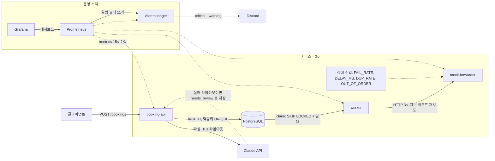
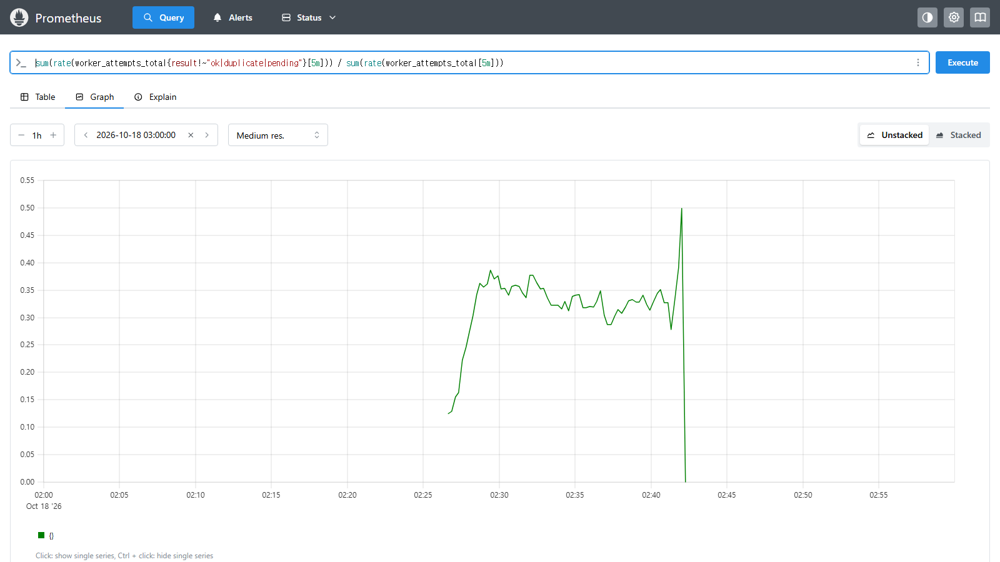
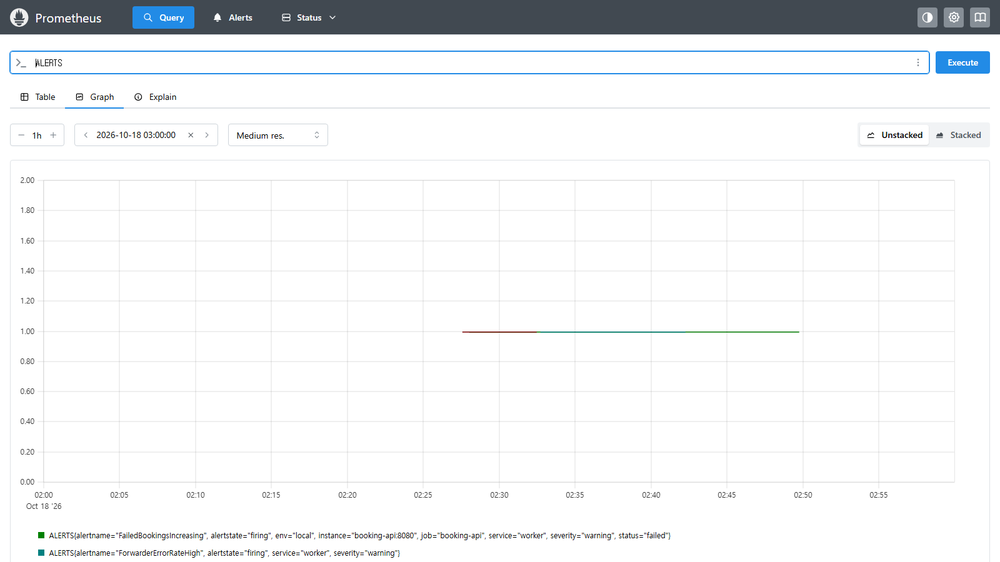

# Booking Ops Lab

해운 부킹 요청을 받아 파싱·저장·포워더 전송까지 처리하는 **작은 서비스**와, 그 서비스를 **안정적으로 운영하는 체계 전체**를 직접 만드는 포트폴리오다. 물류 스타트업 ITOps 엔지니어 포지션 지원용으로, 앱은 일부러 단순하게 두고 모니터링·알림·장애 대응·CI/CD·인프라가 주인공이다.

> 인프라를 코드로 만들고, CI/CD로 안전하게 배포하고, 장애를 사람보다 먼저 감지해 원인을 분석하고, 같은 장애가 반복되지 않게 만든다.

> **2026-10-25 — Azure 실배포 완료 · CD end-to-end 초록 · 자동 롤백 실서버 검증(73초) · 포스트모템 3편**
>
> Terraform 으로 Azure 에 26 리소스를 만들고(`koreacentral`, VM 1대), GitHub Actions CD 가 OIDC 로 로그인해 VM 에 배포하는 것까지 실서버에서 확인했다. 의도적으로 깨진 배포는 사람 개입 없이 73초 만에 이전 버전으로 돌아갔다. 남은 것은 백업·복구 훈련(5번)과 훈련 2·3 포스트모템이다. 기록: [docs/infra.md](docs/infra.md) 8.2절 · [docs/cd.md](docs/cd.md) 11.2절.

## 5분 안에 확인하는 법

1. **CD 자동 롤백** — [Actions › CD](https://github.com/ParkBomJun/booking-ops-lab/actions/workflows/cd.yml) 실행 목록의 연속 세 건: **#4 초록**(첫 end-to-end 성공, 1m 36s) → **#5 빨강**(의도적 결함 `6bb00dc`, deploy job 이 `DEPLOY_RESULT=rolled_back` 로 끝남, 롤백 73초) → **#6 초록**(revert).
2. **무슨 일이 있었나** — [훈련 4번 포스트모템](docs/postmortems/2026-10-25-drill4-auto-rollback.md)과 VM 의 배포 이력 사본 [history.log](docs/postmortems/evidence/drill4/history.log). `rolled_back new=6bb00dc… rollback_to=1d951b2…` 한 줄이 자동 롤백의 증거다.
3. **화면** — [docs/screenshots/](docs/screenshots/README.md). Grafana 는 NSG 로 작업자 IP 에만 열려 있어 외부에서 접속할 수 없으므로 **스크린샷으로 대체**한다.

## 이 저장소가 보여주는 것

| 공고 항목 | 구현 | 증거 |
|---|---|---|
| 모니터링 시스템 구축·운영 | Prometheus가 서비스 3개 + Alertmanager를 15초마다 수집, Grafana 대시보드를 JSON으로 프로비저닝 | [prometheus.yml](infra/monitoring/prometheus.yml) · [대시보드](infra/monitoring/grafana/dashboards/booking-api.json) · [지표 설계](docs/metrics.md) |
| 장애 원인 분석·대응 프로세스 | 장애 주입 → 알림 도착 시간 측정 → 포스트모템. 알림마다 runbook 항목 연결 | [runbook](docs/runbook.md) · [포스트모템 2건](docs/postmortems/) |
| 운영 지표 기반 품질 개선 | 지표 20개의 타입·라벨 선택 근거 문서화. "알림이 평가조차 안 되던" 문제를 지표 선등록으로 개선 | [metrics.md](docs/metrics.md) · [빈 벡터 포스트모템](docs/postmortems/2026-10-18-alert-empty-vector.md) |
| CI/CD 도입·관리 | CI: 서비스 3개에 gofmt · go vet · go test -race · go build · Dockerfile 빌드, 모니터링 설정은 promtool · amtool · JSON/YAML 파싱 검사. CD + 자동 롤백은 3단계 예정 | [ci.yml](.github/workflows/ci.yml) · [Makefile](Makefile) |
| 보안 점검·대응 체계 | 비밀값은 `.env`와 compose secrets로만, distroless nonroot 이미지, 설정 읽기 전용 마운트 | [docker-compose.yml](docker-compose.yml) · [Dockerfile](services/booking-api/Dockerfile) |
| DB 운영 | 바이너리 내장 마이그레이션 + advisory lock, `FOR UPDATE SKIP LOCKED` 큐, 낙관적 잠금. 백업·복구 훈련은 3단계 예정 | [migrations](services/booking-api/migrations/) · [architecture.md](docs/architecture.md) |
| 해운·물류 이해 | 부킹 텍스트에서 UN/LOCODE · 컨테이너 타입 · ETD 추출, 포워더 전송·확인 상태 기계 | [parser.go](services/booking-api/parser.go) · [상태 기계](docs/architecture.md) |
| 반복 업무 자동화 스크립트 | 3단계 예정: `backup.sh` · `restore.sh` · `healthcheck.sh` + cron | — |
| 접근 권한 관리 | 3단계 예정: GitHub Actions OIDC, DB 계정 권한 분리, 접근 통제 문서 | — |
| 클라우드 인프라 운영 | 3단계 예정: Terraform으로 Azure VNet · NSG · VM · Storage · Key Vault, 예산 알림 먼저 | — |

## 구조



- booking-api와 worker는 서로 통신하지 않는다. **DB가 큐 역할**을 하므로 worker가 죽어도 요청은 남는다.
- Claude 파싱이 실패해도 요청은 `needs_review` 상태로 저장된다(외부 의존성 장애의 폴백).
- 별도 프론트엔드는 없다. Grafana가 운영 화면이다. 상세: [docs/architecture.md](docs/architecture.md)

## 빠른 시작

```bash
cp .env.example .env            # ANTHROPIC_API_KEY, GRAFANA_ADMIN_PASSWORD, DISCORD_WEBHOOK_URL 을 채운다
docker compose up -d --build
curl -s localhost:8080/healthz  # {"status":"ok","checks":{"db":"ok"}}
```

WSL에서 Docker Desktop 통합 없이 쓸 때는 `docker.exe compose ...`로 호출하고, 셸 환경변수가 Windows 프로세스에 전달되지 않으므로 값을 바꿀 때는 `--env-file`로 넘긴다.

| 서비스 | 주소 | 용도 |
|---|---|---|
| booking-api | http://localhost:8080 | `POST /bookings`, `GET /bookings/{id}`, `/healthz`(DB 포함), `/metrics` |
| worker | http://localhost:8081 | `/healthz`(DB + 폴러 생존), `/metrics` |
| mock-forwarder | http://localhost:8082 | 모의 포워더. `/metrics`로 주입된 장애 횟수 확인 |
| Prometheus | http://localhost:9090 | 지표 질의, Status → Targets, Alerts |
| Alertmanager | http://localhost:9093 | firing 알림, 억제 상태, silence. info 등급은 여기서만 보인다 |
| Grafana | http://localhost:3000 | admin / `.env`의 `GRAFANA_ADMIN_PASSWORD`. 대시보드 "Booking API — 서비스 지표" |
| PostgreSQL | localhost:5432 | 로컬 디버깅용 노출. 서버에서는 뺀다 |

부킹 등록 (텍스트는 가짜 데이터):

```bash
curl -s -X POST localhost:8080/bookings \
  -H 'Content-Type: application/json' \
  -H 'Idempotency-Key: demo-0001' \
  -d '{"text":"Shipper: Test Shipper Co. Consignee: Demo Consignee Inc. 2 x 40HC, auto parts, Busan to Los Angeles, ETD 2026-11-05"}'
```

- 파싱 성공: `201` + `"status":"parsed"`. `parsed`에 UN/LOCODE(예: `KRPUS`) · 컨테이너 타입 · 수량 등 8개 필드.
- Claude 타임아웃·오류: 그래도 `201` + `"status":"needs_review"`, `review_reason`에 원인(`claude_timeout` 등). 요청은 잃지 않는다.
- 같은 `Idempotency-Key` 재전송: `200` + 기존 행. Claude를 다시 부르지 않는다. 헤더가 없으면 `400`.
- 조회: `curl -s localhost:8080/bookings/1`. worker가 처리하면 `status`가 `parsed → sent → confirmed`로 바뀐다.

## 운영 체계

### 지표 ([docs/metrics.md](docs/metrics.md))
- booking-api `booking_*` 8개: HTTP 요청 수·지연, 처리 결과(`parsed` / `needs_review` / `duplicate`), 상태별 건수, Claude 호출 결과·지연·토큰.
- worker `worker_*` 10개: 포워더 호출 결과·재시도·지연, 상태 전이·역행 거부, version 충돌, 처리 중·대기 건수, 최장 대기 시간, 설정 자동 보정.
- mock-forwarder `forwarder_*` 2개: 주입한 장애가 실제로 발동했는지 증명하는 용도.
- 라우트 라벨은 ServeMux 패턴(`/bookings/{id}`)만 쓰고 미등록 경로는 전부 `unknown`으로 묶어 카디널리티 폭발을 막는다. Prometheus 쪽에도 `sample_limit`를 둔다.

### 알림 — 규칙 11개, 3그룹 ([alert-rules.yml](infra/monitoring/alert-rules.yml) · [alertmanager.yml](infra/monitoring/alertmanager/alertmanager.yml))

| severity | 규칙 | 채널 · 묶음 대기 · 상기 |
|---|---|---|
| critical | `TargetDown`, `BookingProcessingStalled` | Discord · 30s · 1h |
| warning | `ForwarderErrorRateHigh`, `ForwarderLatencyHigh`, `FailedBookingsIncreasing`, `NeedsReviewRatioHigh`, `HttpErrorRateHigh` | Discord · 2m · 4h |
| info | `BacklogAging`, `VersionConflictsObserved`, `ConfigAdjusted`, `NeedsReviewBacklog` | Alertmanager UI 에서만 |

억제 규칙 4개(예: `TargetDown`이 살아 있으면 같은 서비스의 warning/info는 보내지 않음)로 장애 하나에 메시지 하나를 유지한다. 비율 규칙은 전부 `분모 > 0` 조건을 붙여 트래픽 0일 때의 `0/0`을 막는다. 각 규칙의 의미 → 먼저 볼 것 → 조치 → 해제 조건은 [docs/runbook.md](docs/runbook.md).

### 화면 — 장애 훈련 1번 (포워더 실패율 50%, 11분)





위: 실패 비율이 임계값 0.2를 넘어 0.30~0.38에 머물다 원복 후 0으로. 아래: 같은 구간의 `ALERTS` 시계열. 나머지 화면과 캡처 방법은 [docs/screenshots/README.md](docs/screenshots/README.md).

### 로그
모든 서비스가 `log/slog` JSON 한 줄 로그. 요청·처리 범위의 모든 줄에 `booking_id`(= 클라이언트의 멱등키)가 붙고, worker는 `stage` · `attempt` · `result` · `duration_ms`를 더한다. 비밀값은 어떤 로그에도 찍지 않는다(시작 로그는 `api_key_set=true/false`만).

## 장애 훈련과 포스트모템

각 훈련은 **감지 → 알림 → 원인 분석 → 조치 → 재발 방지**를 문서로 남긴다.

| # | 시나리오 | 상태 | 결과 · 배운 것 |
|---|---|---|---|
| 1 | 포워더 실패율 50% → 재시도 폭증 | 재현 완료 | 주입 174건. 약 7분 뒤 `ForwarderErrorRateHigh` firing(비율 0.30), `FailedBookingsIncreasing`도 firing. Alertmanager의 Discord 발송 5건 · 실패 0(도착 시간은 미측정). 장애 주입은 "주입됐다는 증거 지표"부터 확인한다. [화면](docs/screenshots/README.md) · [기록](docs/ai-usage.md) |
| 2 | Claude 타임아웃 → 검토 대기함 급증 | 진행 중 | `CLAUDE_TIMEOUT_MS=1`로 폴백(`needs_review`, `claude_timeout`) 동작은 확인. 알림 도착 시간 측정과 포스트모템 예정 |
| 3 | 같은 부킹 중복 전송 → 멱등성 | 진행 중 | API는 같은 키에 `200` + 기존 행, Claude 미호출 확인. 포워더 `DUP_RATE`(응답 유실) 훈련 예정 |
| 4 | 잘못된 배포 → 헬스체크 실패 → 자동 롤백 | 3단계(CD) 예정 | `TargetDown` 규칙은 준비됨 |
| 5 | DB 손상 → 백업에서 복구, 소요시간 측정 | 3단계 예정 | — |
| 6 | 디스크 급증 → 알림 → 로그 정리 | 3단계 예정 | `DiskUsageHigh` 규칙을 주석으로 준비(node_exporter 필요) |

계획에 없던 장애 2건은 검증 중에 발견해 포스트모템으로 남겼다.

- [worker 임대 라이브락](docs/postmortems/2026-10-18-worker-lease-livelock.md) — 임대 1s가 HTTP 타임아웃 3s보다 짧아 같은 행이 매 틱 다시 집히고, 먼저 끝난 결과는 전부 version 충돌로 버려졌다. 프로세스는 살아 있고 에러 로그도 없어 헬스체크로는 안 보인다. → 시작 시 `lease ≥ 2 × timeout` 검증·자동 보정 + `ConfigAdjusted` 알림. **살아 있는 것과 일이 끝나는 것은 다르다.**
- [알림 규칙의 빈 벡터 문제](docs/postmortems/2026-10-18-alert-empty-vector.md) — 위 라이브락을 잡아야 할 critical 알림이 12분 49초 동안 평가조차 되지 않았다. `rate(counter) == 0`은 시계열이 없으면 0이 아니라 빈 벡터다. → 규칙에 `or vector(0)`, 앱 시작 시 지표를 0으로 선등록. 재검증에서 Discord 도착 3분 18초. **알림은 "울릴 것이다"가 아니라 장애를 주입해 도착 시간을 잰 뒤에 "감지한다"고 적는다.**

## CI/CD

- **CI** ([.github/workflows/ci.yml](.github/workflows/ci.yml)): PR과 main push마다 job 3개가 돈다. ① `go` — 서비스 3개 각각 `gofmt -l` 결과가 비어 있는지 → `go vet` → `go test -race -count=1` → `go build`. ② `docker` — Dockerfile 빌드만 하고 푸시는 안 한다(레이어 캐시는 GitHub Actions 캐시에). ③ `monitoring-config` — compose와 같은 이미지 태그인지 확인한 뒤 `promtool check config` · `promtool check rules` · `amtool check-config`, Grafana 대시보드 JSON·프로비저닝 YAML 파싱. 토큰 권한은 `contents: read`뿐이고 액션은 커밋 SHA로 고정했다. 로컬에서 같은 검사는 `make check`([Makefile](Makefile)). AI가 만든 코드에서 gofmt 미준수가 반복돼(기록된 것만 세 번) gofmt를 CI 관문에 넣었다.
- **CD** (3단계 예정): main 병합 → 이미지 빌드 → GHCR 푸시(커밋 SHA 태그) → VM 반영 → `/healthz` 확인 → **실패 시 이전 태그로 자동 롤백**. Azure 인증은 OIDC.

## 보안 · 접근 통제 현황

지금 있는 것:
- 비밀값은 `.env`(gitignore)에만. Discord 웹훅은 compose `secrets`로 `/run/secrets/` 파일에 마운트되어 설정 파일·이미지·git 어디에도 남지 않는다. API 키는 파서 생성자에만 넘기고 구조체에 보관하지 않는다.
- 서비스 이미지는 멀티스테이지 빌드 → `distroless/static:nonroot`. 셸도 패키지 매니저도 없고 root가 아니다. 이미지 크기는 booking-api 약 31MB(Anthropic SDK · pgx · Prometheus 클라이언트 포함) · worker 약 25MB · mock-forwarder 약 19MB. `/healthz`만 있던 첫 빌드는 18.8MB였다.
- Prometheus · Alertmanager · Grafana 설정은 읽기 전용(`:ro`) 마운트. Grafana는 가입 금지, 기본 비밀번호 금지, 분석 전송 끔.
- 입력 상한: 요청 본문 16KB, 포워더 응답 64KB, 스크레이프 `sample_limit` 1000.
- DB(5432)와 mock-forwarder(8082) 포트는 로컬 디버깅용으로만 열려 있고 compose에 "서버에서는 뺀다"고 적어 두었다.

3단계 예정: GitHub Actions ↔ Azure OIDC(장기 비밀키 없음), Key Vault, NSG(필요한 포트만, SSH는 내 IP만), DB 계정 권한 분리, 보안 점검 체크리스트(`docs/security.md`).

## AI 활용

Claude Code를 페어 프로그래머로 썼고, 설계 결정과 검증은 직접 했다. **AI가 틀리게 만든 부분과 고친 과정은 전부 [docs/ai-usage.md](docs/ai-usage.md)에 기록**한다. 거기서 얻은 교훈 세 가지:

1. **알림 규칙은 문법 검사가 아니라 실제 장애 주입으로 검증한다.** `promtool`을 통과한 critical 규칙이 실제 라이브락에서는 평가조차 되지 않았다(빈 벡터).
2. **"충돌 시 어떻게 할지"뿐 아니라 "충돌이 영원히 반복되지 않는 조건"도 설계에 적는다.** 낙관적 잠금 방침은 정확했지만 임대 > 타임아웃 불변식이 없어 라이브락이 났다.
3. **비밀값 보호와 진단 가능성은 상충하지 않는다.** 키가 섞일까 봐 API 에러 본문을 로그에서 뺐다가 원인 파악에 재현이 필요해졌다. 무엇이 비밀인지 확인하고 그것만 가린다.

## 문서

| 문서 | 내용 |
|---|---|
| [docs/architecture.md](docs/architecture.md) | 구조, 부킹 상태 기계, claim·임대·낙관적 잠금, 재시도·백오프, goroutine 구조, graceful shutdown |
| [docs/metrics.md](docs/metrics.md) | 지표 설계와 타입 선택 근거, 라우트 라벨 규칙, 훈련 ↔ 지표 ↔ 알림 대응 |
| [docs/runbook.md](docs/runbook.md) | 알림별 대응 절차, 심각도·채널, 억제 표, silence 사용법 |
| [docs/postmortems/](docs/postmortems/) | 장애별 포스트모템 (요약 / 영향 / 타임라인 / 감지 / 근본 원인 / 조치 / 재발 방지 / 배운 점) |
| [docs/ai-usage.md](docs/ai-usage.md) | 작업 일지, AI 실수와 수정, 검증 결과 |
| [docs/screenshots/](docs/screenshots/README.md) | 훈련 화면과 캡처 방법 |
| [CLAUDE.md](CLAUDE.md) | 프로젝트 목적, 작업 규칙, 단계별 목표, 범위 줄이기 순서 |

## 한계와 다음 단계

알고 있는 한계:
- 단일 호스트 docker-compose. 포워더는 모의 시스템이고 재시작하면 상태가 비워진다.
- `needs_review` 건을 다시 파싱하는 엔드포인트가 없다(사람 개입 경로 미구현).
- `OUT_OF_ORDER` 주입은 pull 모델에서 역행 전이를 만들지 못해, 역행 거부는 단위 테스트(`store_test.go`)로만 검증했다.
- `BacklogAging`은 라이브락 상황에서 pending/해제를 반복한다. 대기 정의 재검토 필요.
- worker 전용 Grafana 대시보드가 아직 없다. Docker Desktop VM 시계가 호스트와 어긋나 화면이 비었던 적이 있어, 3단계 VM에서는 시간 동기화 점검을 헬스체크에 넣는다.

다음 할 일 (2026-10-25 실배포 뒤, 상태 전부 **과제**):
1. `deploy.sh`: 배포 대상이 현재 태그의 조상(`git merge-base --is-ancestor`)이면 `image_tag` 를 명시한 경우가 아닌 한 거부 — Re-run 이 운영을 한 버전 뒤로 보낸 사고([포스트모템 "부수 발견"](docs/postmortems/2026-10-25-drill4-auto-rollback.md)) 방지.
2. `deploy.sh`: 롤백 완료 시 Discord 에 `rolled_back new=… rollback_to=…` 한 줄 전송.
3. ~~`cd.yml` 에 `paths-ignore: ['docs/**', '**.md']`~~ — 이미 있다. 문서만 바꾼 커밋 `2083a55` 에 CD 가 돌지 않은 것을 Actions 목록으로 확인했다.
4. compose 레벨 `healthcheck` + `depends_on: condition: service_healthy`.
5. `go.mod` 모듈 경로를 `github.com/ParkBomJun/...` 로 변경(import 일괄). 지금은 AI 가 추측한 `rkrsi` 가 남아 있다(빌드엔 영향 없음, [docs/ai-usage.md](docs/ai-usage.md)).
6. 비공개 저장소·GHCR 패키지 지원(배포 키 또는 읽기 PAT 를 Key Vault 에).
7. `backup.sh` → Blob 1회 실행 + 훈련 5번(복구) — 미실행.
8. Dependabot PR #1 (anthropic-sdk-go 1.82→1.84, CI 초록) 머지.

그 뒤 3단계 나머지: 훈련 2 · 3 · 6 포스트모템 → `security.md` → README 에 결과 정리.
