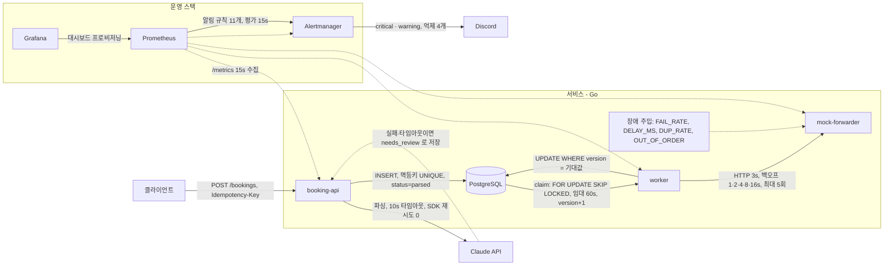

# 구조 (2단계 시점)



텍스트 버전:

```
클라이언트 ──POST /bookings──▶ booking-api ──Claude API(파싱, 10s 타임아웃, 실패 시 needs_review)
                                   │ INSERT (status=parsed, 멱등)
                                   ▼
                              PostgreSQL  ◀──claim/UPDATE── worker ──HTTP(3s)──▶ mock-forwarder
                                                              │                     (FAIL_RATE, DELAY_MS,
                                   /metrics ◀── Prometheus ──▶ /metrics             DUP_RATE, OUT_OF_ORDER)
                                                  │
                                               Grafana        Prometheus ──rules──▶ Alertmanager ──▶ Discord
```

- worker 와 booking-api 는 서로 통신하지 않는다. **DB 가 큐 역할**을 한다. worker 가 죽어도 요청은 DB 에 남는다.
- 별도 프론트엔드 없음. Grafana 가 운영 화면.

## 부킹 상태 기계

| from | to 허용 | 주체 |
|---|---|---|
| `received` | `parsed`, `needs_review` | booking-api |
| `parsed` | `sent`, `failed` | worker (send 단계) |
| `sent` | `confirmed`, `failed` | worker (confirm 단계) |
| `needs_review` | `parsed` | 사람 (미구현) |
| `confirmed`, `failed` | 없음 (종결) | |

worker 는 시작 시 이 표의 모든 (from,to) 조합을 `worker_transitions_total` 에 0 으로 선등록한다. Counter 는 첫 증가 전에는 시계열이 없어 "전이 0 건" 과 "지표 없음" 이 구분되지 않고, 그러면 정체 알림이 재시작 직후에는 평가조차 되지 않기 때문이다(`docs/postmortems/2026-10-18-alert-empty-vector.md`).

표 밖의 전이는 worker 가 거부하고 `worker_transition_rejected_total{from,to}` 로 센다. 포워더가 `OUT_OF_ORDER` 로 `confirmed` 뒤에 `pending` 을 돌려줘도 `confirmed → sent` 는 표에 없어 버려진다. 코드: `services/worker/store.go` 의 `allowedTransitions`.

## worker 가 행을 집어가는 방법 (claim)

마이그레이션 002 가 추가한 컬럼: `attempts`, `next_attempt_at`, `claimed_until`, `forwarder_ref`, `last_error`. `status` 에는 새 값을 넣지 않았다. "처리 중" 은 `claimed_until`(임대) 로만 표현한다.

```sql
UPDATE bookings SET claimed_until = now() + lease, version = version + 1
 WHERE id IN (SELECT id FROM bookings
               WHERE status IN ('parsed','sent') AND next_attempt_at <= now()
                 AND (claimed_until IS NULL OR claimed_until < now())
               ORDER BY next_attempt_at LIMIT n FOR UPDATE SKIP LOCKED)
RETURNING ...;
```

- `FOR UPDATE SKIP LOCKED`: 다른 트랜잭션이 잡은 행은 건너뛴다. worker 가 여러 개여도 같은 행을 두 번 집지 않는다.
- 트랜잭션은 이 문장 하나. HTTP 호출 중에는 DB 락을 들고 있지 않다.
- 임대 60초. worker 가 HTTP 호출 중 죽으면 60초 뒤 자동으로 다시 대상이 된다. 별도 복구 로직 없음.
- **불변식: 임대 > HTTP 타임아웃.** 임대가 호출보다 먼저 만료되면 매 틱 같은 행이 재claim 되고 모든 마무리 쓰기가 version 충돌로 버려져 행이 영원히 끝나지 않는다(라이브락). worker 는 시작 시 `lease < 2 × httpTimeout` 이면 경고를 남기고 `2 × httpTimeout` 으로 올린다.
- 부분 인덱스 `idx_bookings_worker_eligible` 가 `parsed/sent` 행만 색인해 종결 행이 쌓여도 폴링 비용이 일정하다.

## 재시도·타임아웃

- 호출당 타임아웃 3초 (`context.WithTimeout`).
- 재시도: 타임아웃, 연결 오류, 5xx, (confirm 단계) pending. **4xx 는 즉시 `failed`** — 우리 요청이 잘못된 것이라 반복해도 같다. 409 와 200 은 "이미 받음" 으로 성공 처리.
- 지수 백오프 1·2·4·8·16s, 상한 30s, ±20% 지터(재시도가 같은 순간에 몰리는 것을 막음). 최대 5회 초과 시 `failed` + `last_error`.
- 백오프는 **`next_attempt_at` 컬럼에 기록**한다. goroutine 이 자지 않으므로 재시작해도 대기 시간이 유지되고, 잠든 goroutine 이 쌓이지 않는다.

## version 과 낙관적 잠금

모든 쓰기는 `UPDATE ... WHERE id = $1 AND version = $2` 이고 성공 시 `version + 1`. claim 도 version 을 올리며, worker 는 그 값을 기억해 마무리 쓰기에 쓴다.

**0행 갱신(version 불일치) 방침**: 덮어쓰지 않고, 쓰기를 재시도하지 않고, 전송도 다시 하지 않는다. 행을 다시 읽어 기대/실제 version 과 상태를 로그로 남기고 `worker_version_conflicts_total` 을 올린 뒤 그 건은 끝낸다. 아직 처리 대상이면 다음 폴링에서 새 version 으로 다시 집힌다. 이 상황은 임대 만료 후 다른 worker 가 같은 행을 다시 집었을 때 생기며, HTTP 가 두 번 나갔을 수 있으니 포워더 쪽 `Idempotency-Key` 멱등성이 받쳐준다.

## goroutine 과 channel (`services/worker/main.go` 의 `run`)

| 어디에 | 왜 |
|---|---|
| 폴러 1개 (`time.Ticker`, 1s) | DB 를 두드리는 곳을 한 군데로. 쿼리 수가 goroutine 수에 비례하지 않는다 |
| 처리기 N개 (`WORKER_CONCURRENCY`=4) | 포워더가 느려도 처리량이 직렬로 무너지지 않게. N 은 상한 |
| `chan Booking` (버퍼 N) | 폴러→처리기 큐. channel 수신은 "꺼내기" 라 한 건은 정확히 한 goroutine 에만 간다. 버퍼가 차면 폴러가 멈춰 자연스러운 배압이 된다 |
| HTTP 서버 goroutine | `/healthz`, `/metrics`. `ListenAndServe` 가 블로킹이라 분리 |

쓰지 않는 것: 건당 goroutine(무제한), 공유 map(상태는 DB 에만), 백오프용 `time.Sleep`.

**graceful shutdown**: SIGTERM → `signal.NotifyContext` 의 ctx 취소 → 폴러가 claim 중단 → `close(jobs)` → 처리기들이 버퍼에 남은 건을 끝내고 `range` 종료 → `wg.Wait()` 반환 → HTTP 서버·DB 풀 종료. 처리 중인 건은 shutdown ctx 가 아닌 자체 타임아웃(3s) 을 쓰므로 "포워더엔 보냈는데 DB 엔 못 쓴" 반쪽 상태로 죽지 않는다. compose 의 `stop_grace_period: 15s` 가 이 드레인 시간을 보장한다.

## mock-forwarder

in-memory map + 뮤텍스(net/http 는 요청마다 goroutine 을 띄우므로 map 동시 쓰기 보호 필요). 상태는 `pending` → (`CONFIRM_AFTER_MS` 후) `confirmed`.

| 환경변수 | 동작 |
|---|---|
| `FAIL_RATE` | 그 확률로 500, 저장 안 함 |
| `DELAY_MS` | 응답 전 지연. 3000 이상이면 worker 타임아웃 |
| `DUP_RATE` | **저장은 하고** 500 (응답 유실). 재전송 시 같은 키를 인식해 200 + 같은 ref |
| `OUT_OF_ORDER` | GET 의 30% 가 옛 상태 `pending` 반환 |

## 포트 (로컬)
| 서비스 | 포트 |
|---|---|
| booking-api | 8080 |
| worker | 8081 |
| mock-forwarder | 8082 |
| Prometheus | 9090 |
| Alertmanager | 9093 |
| Grafana | 3000 |
