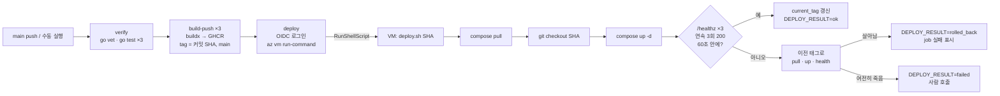

# CD — 빌드 · 배포 · 자동 롤백

main 에 커밋이 들어오면 이미지 3개를 만들어 GHCR 에 올리고, Azure VM 에서 `scripts/deploy.sh` 가 새 이미지를 띄운 뒤 `/healthz` 를 본다. 건강하지 않으면 **스크립트가 스스로 이전 태그로 되돌린다.** CI(검사)는 [`docs/ci.md`](ci.md), 인프라는 [`infra/terraform/README.md`](../infra/terraform/README.md), 백업은 [`docs/backup.md`](backup.md).

파일: [`.github/workflows/cd.yml`](../.github/workflows/cd.yml) · [`docker-compose.prod.yml`](../docker-compose.prod.yml) · [`scripts/deploy.sh`](../scripts/deploy.sh) · [`scripts/healthcheck.sh`](../scripts/healthcheck.sh)

**상태: 코드만 있다. 아직 한 번도 실제로 돌지 않았다** (VM 이 없다). 실제 실행 뒤 이 문서의 "검증 기록" 을 채운다.

## 1. 한눈에



텍스트 버전:
```
GitHub Actions                                   Azure VM (/opt/booking-ops-lab)
verify ──▶ build-push ──▶ deploy ──az vm run-command──▶ deploy.sh <sha>
(vet/test)  (GHCR push)   (OIDC)                         │ .env IMAGE_TAG=<sha> → compose pull → git checkout <sha> → compose up -d
                                                         │ /healthz 8080·8081·8082 (127.0.0.1) 연속 3회 200?
                                                         ├─ 예: current_tag=<sha>, previous_tag=<이전>, DEPLOY_RESULT=ok
                                                         └─ 아니오: IMAGE_TAG=<이전> → pull(로컬 우선) → up → health
                                                               ├─ 복구됨: DEPLOY_RESULT=rolled_back (job 은 빨강)
                                                               └─ 안 됨: DEPLOY_RESULT=failed (사람)
```

### 설계 결정 (면접 요약)

| 결정 | 선택 | 이유 |
|---|---|---|
| CI 게이트 | `cd.yml` 안에서 vet·test 를 **한 번 더 돌린다** (`verify` job). `workflow_run` 으로 CI 에 묶지 않음 | 아래 "CI 게이트" 절 |
| 이미지 태그 | **커밋 SHA 전체(40자)** + `main` | `github.sha` 와 글자가 같아 변환이 없다. 짧은 SHA 는 드물게 충돌. `main` 은 사람이 "최신" 을 찾을 때용, 배포엔 안 쓴다 |
| 동시 실행 | 워크플로 전체를 `deploy-production` 그룹 하나로, 취소 없음 | 배포 순서 보존 + 반쯤 바뀐 VM 방지 |
| VM 접근 | `az vm run-command` (SSH 아님) | GitHub 러너에 22 번을 열 필요가 없다. NSG 의 SSH 는 내 IP 만 그대로 |
| 포트 | 앱·Prometheus·Alertmanager 는 **127.0.0.1 바인딩**, postgres 는 포트 없음, Grafana 만 3000 공개(NSG 로 내 IP 만) | 루프백은 NSG 가 틀려도 바깥에서 못 닿는다. 스크립트는 그냥 `curl 127.0.0.1` 로 확인 |
| worker 건강 확인 | 127.0.0.1:8081 바인딩 + 호스트 curl | 대안(`docker run curlimages/curl`)은 배포 중에 이미지를 하나 더 받아야 해서 "확인하려다 실패" 가 생긴다. 루프백 바인딩은 추가 의존성이 0 |
| 이미지 pull | `pull_policy: missing`, 롤백은 `pull --policy missing` | 이전 이미지는 디스크에 있다. **GHCR 이 죽어도 롤백은 된다** |
| 설정 파일 | deploy.sh 가 `git checkout <sha>` 로 compose·prometheus.yml 도 같은 커밋에 맞춘다 | 이미지만 바꾸고 설정은 옛것이면 반쪽 배포. 롤백도 설정까지 같이 돌아간다 |
| 결과 전달 | 마지막 줄 `DEPLOY_RESULT=ok\|rolled_back\|failed` | run-command 는 스크립트 종료 코드를 전달하지 않는다. 출력도 4KB 에서 잘린다 → 마지막 줄 하나로 판정 |

### CI 게이트: 왜 `workflow_run` 이 아니라 재검사인가

| | `workflow_run`(CI 끝나면 CD 시작) | `verify` job 재검사 (선택) |
|---|---|---|
| 장점 | 검사를 두 번 안 돈다 | 파일 하나로 닫힌다. `github.sha` 가 그대로 배포 대상이다. `paths-ignore` 가 그대로 먹는다 |
| 단점 | CI 워크플로 **이름**에 묶인다(다른 사람이 ci.yml 을 바꾸면 깨짐). 항상 기본 브랜치의 cd.yml 로 돌고 `github.sha` 가 트리거 커밋이 아니라 `workflow_run.head_sha` 를 따로 읽어야 한다. CI 가 `paths` 필터로 안 돌면 CD 도 영원히 안 돈다 | vet·test 1~2분이 중복된다 |

중복 비용(분 단위)보다 "한 파일에 다 보인다" 가 지금 단계에 맞다. 실제 관문은 **브랜치 보호(PR 에서 CI 통과 필수)** 이고 `verify` 는 그 뒤의 안전망이다. 이미지 빌드 자체도 컴파일이라 빌드 실패 = 배포 중단이다.

## 2. `cd.yml` 줄 단위

### 2.1 머리
| 줄 | 뜻 |
|---|---|
| `on.push.branches: [main]` | main 에 들어온 커밋만. PR·다른 브랜치는 CI 만 돈다 |
| `paths-ignore: docs/**, **.md` | 문서만 바뀐 커밋은 배포하지 않는다. 이미지에 들어가는 파일이 없다 |
| `workflow_dispatch.inputs.image_tag` | 수동 실행. 값을 주면 **빌드 없이** 그 태그를 배포(= 롤백·재배포). 비우면 현재 커밋을 빌드해 배포 |
| `permissions: contents: read` | `GITHUB_TOKEN` 기본 권한을 읽기로. 필요한 job 에서만 더한다 |
| `concurrency.group: deploy-production` | 같은 그룹은 동시에 하나만. 뒤에 온 run 은 기다린다. 대기열엔 가장 최근 하나만 남고 그 사이 것은 GitHub 이 취소한다 |
| `cancel-in-progress: false` | 배포 **도중** 취소하면 VM 이 반쯤 바뀐 상태(.env 는 새 태그, 컨테이너는 옛것)로 남는다. 끝까지 하고 다음 것을 돌린다 |
| 워크플로 단위 그룹 | job 단위로 묶으면 커밋 A 의 느린 빌드가 커밋 B 배포 뒤에 끝나 **옛 코드 A 가 마지막에 올라갈 수 있다.** 전체를 직렬화하면 순서가 보존된다. 빌드가 겹치지 않는 대가는 수 분 |
| `env.IMAGE_PREFIX: ghcr.io/${{ github.repository }}` | `ghcr.io/rkrsi/booking-ops-lab`. 세 서비스가 이 아래에 붙는다 |

### 2.2 `verify`
| 줄 | 뜻 |
|---|---|
| `if: ${{ !inputs.image_tag }}` | 태그 지정 수동 실행(이미 빌드된 이미지 재배포)은 건너뛴다. push 때는 `inputs` 가 비어 있어 참 |
| `runs-on: ubuntu-24.04` | ci.yml 과 같은 러너. `latest` 는 어느 날 바뀐다 |
| `strategy.matrix.service` | 서비스 3개를 병렬로. 하나가 실패하면 나머지는 중단(기본 `fail-fast`) — 어차피 배포는 막힌다 |
| `actions/checkout@<sha> # v7.0.1` | 액션은 **커밋 SHA 로 고정**한다. 태그는 누군가 옮길 수 있고 SHA 는 바뀌지 않는다. 주석의 버전은 사람용. SHA 는 `gh api repos/<owner>/<repo>/git/ref/tags/<tag>` 로 확인했다 (주석 태그 `tag` 객체면 한 번 더 역참조) |
| `setup-go` `go-version-file` | Go 버전은 go.mod 한 곳에서만 관리. `cache-dependency-path` 는 go.sum 기준 모듈 캐시 |
| `go vet ./...` / `go test ./... -count=1` | ci.yml 의 핵심 두 가지. `-count=1` 은 테스트 캐시 무시 |

### 2.3 `build-push`
| 줄 | 뜻 |
|---|---|
| `needs: verify` + 같은 `if` | verify 가 실패하면 여기는 건너뛴다 |
| `permissions.packages: write` | GHCR push. `GITHUB_TOKEN` 으로 충분 — **PAT 를 만들지 않는다** |
| `docker/setup-buildx-action` | BuildKit 빌더. `type=gha` 캐시는 buildx 여야 쓸 수 있다 |
| `docker/login-action` `registry: ghcr.io`, `username: github.actor`, `password: GITHUB_TOKEN` | 이 run 에만 유효한 토큰으로 로그인. 장기 비밀키 없음 |
| `docker/metadata-action` `type=sha,format=long,prefix=` | 태그 = 커밋 SHA 40자. `prefix=` 로 기본 접두어 `sha-` 를 뗀다 |
| `type=raw,value=main` | 두 번째 태그 `main`. 최신 포인터 |
| 라벨 | `org.opencontainers.image.source` 등이 자동으로 붙어 GHCR 패키지가 저장소에 연결된다 |
| `build-push-action` `context`/`file` | 서비스 폴더만 컨텍스트. Dockerfile 의 `COPY . .` 범위 |
| `platforms: linux/amd64` | VM 이 amd64. 다중 아키텍처는 빌드 시간만 늘린다 |
| `push: true` | 빌드 결과를 레지스트리로. `load`(러너 데몬에 적재)는 안 한다 |
| `cache-from/to: type=gha,scope=<service>` | GitHub Actions 캐시에 레이어 저장. **CI 의 docker job 과 같은 scope** 라 CI 가 만든 레이어를 그대로 쓴다. `mode=max` 는 중간 레이어까지 |
| `provenance: false` | 켜면 이미지가 "인덱스 + 증명서 매니페스트" 가 되어 GHCR 화면에 `unknown/unknown` 항목이 생긴다. 단일 아키텍처·개인 프로젝트는 단순한 매니페스트. 공급망 증명은 개선 과제 |
| `digest 기록` | `steps.build.outputs.digest` (`sha256:…`) 를 run 요약(`$GITHUB_STEP_SUMMARY`) 에 남긴다. 태그는 옮길 수 있지만 digest 는 내용이 같을 때만 같다. matrix job 의 `outputs` 는 마지막 인스턴스가 덮어쓰므로 job output 대신 요약을 쓴다 |

### 2.4 `deploy`
| 줄 | 뜻 |
|---|---|
| `needs: build-push` + `if: !cancelled() && (성공 ∥ (건너뜀 ∧ image_tag 있음))` | 빌드 성공 뒤, 또는 태그 지정 수동 실행이라 빌드를 건너뛴 경우. **verify 실패로 건너뛴 경우는 제외** (image_tag 가 비어 있으므로) |
| `timeout-minutes: 30` | run-command 자체 상한은 90분. 그 전에 끊는다 |
| `environment: production` | OIDC 토큰의 subject 가 `repo:rkrsi/booking-ops-lab:environment:production` 이 된다. Terraform 의 `azuread_application_federated_identity_credential.production_environment` 와 글자 그대로 일치해야 한다. 환경 보호 규칙(승인자)을 붙일 자리이기도 하다 |
| `permissions.id-token: write` | OIDC 토큰 발급 권한. 없으면 `azure/login` 이 "Unable to get ACTIONS_ID_TOKEN_REQUEST_URL" 로 실패 |
| `env.AZURE_RESOURCE_GROUP/VM_NAME: vars.*` | 비밀이 아니므로 variables. Terraform output `resource_group_name`, `vm_name` 값 |
| 태그 결정 | `inputs.image_tag` 가 있으면 그것, 없으면 `github.sha`. **16진수 7~40자만 허용** — 아래에서 셸 명령에 끼워 넣으므로 |
| `azure/login` `client-id/tenant-id/subscription-id` | 비밀키 없는 로그인. GitHub 이 준 OIDC 토큰을 Entra 가 연합 자격증명과 대조해 짧은 수명의 토큰을 준다. `creds`(JSON 비밀키) 는 쓰지 않는다 |
| `remote.sh` 생성 | VM 안에서 실행할 네 줄. `deploy.sh` 출력 전체를 `/var/log/booking-deploy-last.out` 에 두고 **마지막 3000 바이트만** 돌려받는다 |
| 왜 tail 인가 | run-command 는 출력을 마지막 4096 바이트만 돌려주고 stdout 뒤에 stderr 를 붙인다. stderr 가 길면 stdout(결과 마커)이 밀려 사라진다. `2>&1` 로 한 파일에 모아 끝을 보낸다 |
| `az vm run-command invoke --command-id RunShellScript --scripts @remote.sh` | VM 에이전트(waagent)가 **root 로** 실행. 동기 호출이라 끝날 때까지 기다린다 |
| `jq -r '.value[0].message'` | 응답 JSON 의 화면 출력 부분(`[stdout] … [stderr] …`) |
| `grep -o 'DEPLOY_RESULT=…' \| tail -n 1` | 마지막 마커만. run-command 는 스크립트의 종료 코드를 전달하지 않으므로 이것이 유일한 판정 근거 |
| 결과 판정 | `ok` → notice. `rolled_back` → **job 실패**(VM 은 이전 버전으로 살아 있음). `failed` → job 실패(사람). 마커 없음 → job 실패(잘림·VM 도달 불가·스크립트 없음) |

## 3. `docker-compose.prod.yml`

서버에서만 겹치는 파일. `docker compose -f docker-compose.yml -f docker-compose.prod.yml …`. 로컬 파일은 손대지 않았다.

| 바꾼 것 | 어떻게 | 왜 |
|---|---|---|
| 이미지 출처 | `build: !reset null`, `image: ghcr.io/rkrsi/booking-ops-lab/<svc>:${IMAGE_TAG:?…}` | VM 은 빌드하지 않는다. `:?` 는 IMAGE_TAG 가 비면 즉시 에러 — `booking-api:` 같은 잘못된 이름으로 조용히 실패하지 않게 |
| `pull_policy: missing` | 로컬에 없을 때만 pull | SHA 태그는 불변. 롤백 때 GHCR 무의존 |
| 포트 | postgres `ports: !reset []`, 앱 3개·Prometheus·Alertmanager `ports: !override ["127.0.0.1:<p>:<p>"]`, Grafana 는 그대로 `3000:3000` | compose 는 리스트를 **합치므로** 지우려면 `!reset`, 바꾸려면 `!override`. 루프백은 바깥에서 못 닿는다. UI 는 `ssh -L 9090:127.0.0.1:9090 opsadmin@<vm>` |
| Grafana 공개 | 3000 전체 인터페이스 | 운영 화면이라 브라우저로 봐야 한다. 통제 두 겹: NSG(`my_ip_cidr` 만) + Grafana 로그인(가입 금지). 더 조이려면 `127.0.0.1:3000:3000` + SSH 터널 |
| 로그 상한 | `x-logging` 앵커 → 전 서비스 `json-file`, `max-size 10m`, `max-file 3` | 컨테이너당 최대 30MB. 없으면 로그가 디스크를 채운다 (훈련 6번) |
| Prometheus 디스크 | `--storage.tsdb.retention.size=2GB` 추가 | `command` 는 리스트지만 합쳐지지 않고 **통째로 교체**되므로 4줄을 다 다시 적었다 |
| restart | 바꾸지 않음 (`unless-stopped`) | 장애 대응 중 사람이 `docker stop` 한 컨테이너가 재부팅 뒤 멋대로 살아나지 않게. 재부팅으로 죽은 것은 다시 뜬다 |

검증(로컬, 비밀값 없이): `docker compose --env-file .env.example --env-file .env.prodtest -f docker-compose.yml -f docker-compose.prod.yml config` → `build:` 사라짐, postgres 포트 없음, 5개 서비스 `host_ip: 127.0.0.1`, grafana `published: "3000"`, 로그 옵션 7개 서비스, retention 두 줄. (`--env-file` 을 주면 `.env` 자동 로드가 꺼지므로 `.env.example` 의 가짜 값으로 돌릴 수 있다.)

## 4. `scripts/deploy.sh` 블록별

| 블록 | 하는 일 | 왜 이렇게 |
|---|---|---|
| `set -euo pipefail` | 실패 즉시 중단, 미정의 변수 금지, 파이프 중간 실패도 실패 | 배포 스크립트가 "조용히 반쯤 성공" 하는 것이 최악 |
| 설정 변수 | `REPO_DIR`, `ENV_FILE`, `STATE_DIR`, `LOG_FILE`, `HEALTH_*` 전부 환경변수로 덮어쓰기 가능 | 로컬에서 가짜 docker 와 가짜 /healthz 로 전체 경로를 시험했다(아래 검증 기록) |
| `log` / `stamp` / `run` | 모든 줄에 UTC 시각, 로그 파일과 stdout 양쪽 | `printf '%(…)T'` 는 bash 내장이라 줄마다 `date` 프로세스를 안 띄운다 |
| `trap finish EXIT` | 어떤 경로로 끝나든 마지막 줄 `DEPLOY_RESULT=` 보장. `set -e` 로 튕겨도 `failed` | CD 는 이 줄만 본다. 마커가 없으면 "모름" 이고 그것도 실패다 |
| 로그 파일 fallback | `/var/log` 에 못 쓰면 `.deploy/deploy.log` | 로그 때문에 배포가 죽으면 안 된다 |
| 태그 검증 | `^[0-9a-f]{7,40}$` | sed 패턴·셸에 끼워 넣기 전에. CD 쪽에서도 같은 검사 |
| `flock -n 9` | 잠금 파일을 fd 9 로 열고 기다리지 않는 잠금 | 두 배포가 겹치면 .env 와 컨테이너가 섞인다. 스크립트가 끝나면 fd 가 닫혀 자동 해제 |
| `current_tag` / `previous_tag` / `ROLLBACK_TAG` | 지금 돌고 있는 태그와 그 전 태그. 같은 태그 재배포(재시도)면 롤백 대상은 previous | 첫 배포는 롤백 대상이 없다 → 실패 시 `failed` |
| `compose()` | `--project-directory`, `--env-file`, `-f` 두 개를 한 곳에 | `--env-file` 을 주면 `.env` 자동 로드가 꺼지므로 명시 |
| `set_image_tag` | `.env` 끝 줄바꿈 보장 → `IMAGE_TAG=` 줄 교체 또는 추가 | 끝 줄바꿈이 없으면 새 줄이 마지막 줄 뒤에 붙어 무시된다 — 훈련 1번 때 겪은 일. `sed -i` 는 root 로 돌아도 원래 소유자·권한을 보존 |
| `git_` | root 면 저장소 **소유자(opsadmin)** 로 `runuser` 해서 git 실행 | cloud-init 이 opsadmin 소유로 clone 했다. root 가 그냥 돌리면 "dubious ownership", 억지로 돌리면 .git 에 root 파일이 생겨 이후 opsadmin 의 git 이 깨진다 |
| `sync_repo` | `fetch` → 커밋이 없으면(`--depth 1` 얕은 클론) `--unshallow` → `checkout --detach <sha>` | compose·모니터링 설정을 이미지와 같은 커밋으로. 스크립트 자신이 바뀌어도 bash 는 이미 연 inode 를 읽고, 본문은 전부 함수라 끝의 `main` 호출 전에 파싱이 끝나 있다 |
| 순서: `set_image_tag → pull → sync_repo → up` | pull 과 sync 는 **아무것도 재시작하지 않는다.** 둘 중 하나가 실패하면 태그를 되돌리고 `failed` — 롤백 불필요 | "태그가 GHCR 에 없음" 같은 흔한 실수가 서비스에 닿지 않는다 |
| `compose up -d --remove-orphans --quiet-pull` | 바뀐 서비스만 재생성. 사라진 서비스의 컨테이너 정리 | |
| `wait_healthy` | 3개 URL 이 **연속 3회**(2초 간격) 200 이어야 성공. 60초 상한 | "뜨자마자 죽는" 크래시 루프를 한 번의 200 으로 통과시키지 않기 위해. `curl -m 3` 으로 한 번의 확인이 매달리지 않는다 |
| `dump_state` | 실패 시 `compose ps` + 앱 3개 로그 40줄을 **로그 파일에만** | stdout 은 4KB 제한. 원인 분석은 VM 의 `/var/log/booking-deploy.log` |
| `rollback` | 이전 태그로 `set_image_tag → sync_repo(실패 허용) → pull --policy missing(실패 허용) → up → wait_healthy` | 되밟는 경로가 같다. pull 은 로컬 이미지가 있으면 건너뛰므로 GHCR 장애 중에도 된다. 복구되면 `rolled_back`(exit 1), 안 되면 `failed`(exit 2) |
| 성공 기록 | `previous_tag`, `current_tag`, `history.log` 한 줄 | `history.log` 가 "자동 롤백이 실제로 일어났다" 의 증거. README 에 그대로 옮길 수 있다 |
| `docker image prune -f` | **태그 없는** 이미지만 | `-a` 는 안 쓴다 — 이전 태그 이미지를 지우면 롤백이 GHCR 에 의존하게 된다. 옛 SHA 이미지는 쌓인다(개당 ~20MB, 정리는 개선 과제) |

종료 코드: `0` ok · `1` rolled_back(이전 버전으로 살아 있음) · `2` failed(사람).

## 5. `scripts/healthcheck.sh` 블록별

로컬(WSL + Docker Desktop)과 VM 에서 **같은 파일**. 종료 코드 `0` = CRIT 없음(WARN 허용), `1` = CRIT 있음. `set -e` 를 일부러 빼서 한 점검이 실패해도 나머지를 끝까지 돈다.

| 항목 | 방법 | 판정 |
|---|---|---|
| containers | `docker ps -a` 와 기대 목록 7개 비교, `RestartCount` 합산. docker 명령은 `docker` → `docker.exe` 순으로 자동 선택, `\r` 제거 | 없거나 running 이 아니면 CRIT, 재시작 흔적은 WARN |
| healthz ×3 | `curl 127.0.0.1:{8080,8081,8082}/healthz`, 본문 뒤에 `\n%{http_code}` | 200 아니면 CRIT |
| prometheus targets | `/api/v1/targets` 의 `health` 집계 | 하나라도 down 이면 CRIT(= TargetDown) |
| alerts firing | `/api/v1/alerts` 를 severity 로 집계, 이름 나열 | critical 있으면 CRIT, warning 은 WARN, info 는 OK |
| disk | `df -P /` 사용률 + `docker system df` | 80% WARN(알림 규칙과 같은 값), 90% CRIT |
| time sync | `chronyc tracking`(Leap status Normal) → 없으면 `timedatectl` NTPSynchronized | 아니면 WARN |
| container clock | Prometheus `query=time()` 의 값 − 호스트 시각. Prometheus 가 죽었으면 `docker exec booking-postgres date` | 5초 WARN, 60초 CRIT. **2026-10-18 에 5시간 40분 어긋나 그래프가 비었던 사건**의 재발 감지 |
| last backup | `backups/LAST_SUCCESS` 1행(UTC 시각)의 나이. 마커가 없으면 가장 새 `*.dump` 의 mtime | 26시간 초과 WARN. 기록이 없으면 INFO |
| deployed tag | `.deploy/current_tag` | INFO |

JSON 파싱은 `python3 -I -c`(jq 는 Ubuntu 기본 설치가 아니고 python3 는 있다). `-I` 는 현재 디렉터리의 `.py` 를 모듈로 집지 않게 한다.

## 6. 롤백 이야기 — 훈련 4번

### 무엇이 일어나는가 (예상 타임라인, 60초 상한 기준)
| T+ | 어디 | 일 |
|---|---|---|
| 0:00 | GitHub | 깨진 커밋 push → verify 통과(테스트가 못 잡는 종류의 결함) → 이미지 3개 push |
| ~3:00 | VM | `deploy.sh <bad>`: `.env` IMAGE_TAG 교체, pull, checkout, `up -d` |
| +0:02 | VM | `/healthz` 폴링 시작. 깨진 서비스는 503 또는 연결 거부(크래시 루프: `restart: unless-stopped` 가 계속 띄움) |
| +1:00 | VM | 60초 상한 → `dump_state`(ps + 로그 40줄을 파일에) → `rolling back to <prev>` |
| +1:05 | VM | 이전 태그 `up -d`(이미지는 디스크에 있음) → 연속 3회 200 → `DEPLOY_RESULT=rolled_back`, `history.log` 에 `rolled_back new=<bad> rollback_to=<prev>` |
| +1:10 | GitHub | job 빨강: "health check failed on <bad>; VM rolled back". run 요약에 출력 끝 1500자 |
| 병행 | Prometheus | 죽은 서비스의 `up==0` 이 1분 이상이면 `TargetDown`(critical, `for: 1m`) → Discord. 롤백이 60초 안이면 pending 에서 끝날 수도 있다. **CD 가 알림보다 먼저 잡는 것이 정상**이고 알림은 뒷단 안전망 |

### 어떻게 재현하나 (VM 이 생긴 뒤)
1. 정상 배포를 한 번 끝내 `previous_tag` 가 생기게 한다 (첫 배포는 롤백 대상이 없다).
2. 깨진 커밋 하나. 두 가지 중 하나:
   - 코드: `services/booking-api/main.go` 의 서버 시작 직전에 `os.Exit(1)` 또는 `/healthz` 가 503 을 돌려주게 → 이미지는 멀쩡히 빌드되지만 뜨자마자 죽는다 (테스트가 못 잡는 결함의 모형).
   - 설정: `docker-compose.prod.yml` 의 booking-api `PORT` 를 `18080` 으로 → 컨테이너는 살지만 8080 에 아무도 없다. **설정도 함께 롤백되는 것**을 보여준다.
3. push → Actions 에서 deploy job 이 빨강으로 끝나는지, 출력에 `rolled_back` 이 있는지.
4. VM: `cat /opt/booking-ops-lab/.deploy/history.log`, `tail -50 /var/log/booking-deploy.log`, `scripts/healthcheck.sh`(deployed tag 가 이전 SHA).
5. Discord/Alertmanager: TargetDown 이 울렸는지·pending 에서 끝났는지 시각을 적는다.
6. 깨진 커밋을 revert 해 push → 정상 배포 → 포스트모템 `docs/postmortems/` (요약 / 영향 / 타임라인 / 감지 / 근본 원인 / 조치 / 재발 방지 / 배운 점).

수동 롤백(사람이 특정 버전으로): Actions → CD → Run workflow → `image_tag` 에 돌아갈 SHA. verify·build 를 건너뛰고 deploy 만 돈다. VM 에서 직접: `sudo /opt/booking-ops-lab/scripts/deploy.sh <sha>`.

## 7. 필요한 GitHub 설정과 Azure 권한

Environment `production` 을 만들고 비밀값은 **환경 범위**에 둔다 (`environment: production` 인 job 만 읽을 수 있다). 값은 전부 `terraform output` 에서 나온다.

| 이름 | 종류 | 값 출처 | 예 |
|---|---|---|---|
| `AZURE_CLIENT_ID` | secret | `terraform output github_secret_AZURE_CLIENT_ID` (앱 등록 client id) | `00000000-0000-0000-0000-000000000000` |
| `AZURE_TENANT_ID` | secret | `terraform output github_secret_AZURE_TENANT_ID` | `00000000-0000-0000-0000-000000000000` |
| `AZURE_SUBSCRIPTION_ID` | secret | `terraform output github_secret_AZURE_SUBSCRIPTION_ID` | `00000000-0000-0000-0000-000000000000` |
| `AZURE_RESOURCE_GROUP` | variable | `terraform output resource_group_name` | `rg-booking-ops-lab-dev` |
| `AZURE_VM_NAME` | variable | `terraform output vm_name` | `vm-booking-ops-lab-dev` |

ID 세 개는 비밀값은 아니지만(공개돼도 OIDC 없이는 쓸 수 없다) 공개 저장소의 로그에 남길 이유도 없어 secret 으로 둔다.

Azure 쪽(Terraform `infra/terraform/github-oidc.tf` 가 만든다):

| 항목 | 값 |
|---|---|
| 연합 자격증명 issuer | `https://token.actions.githubusercontent.com` |
| subject | `repo:rkrsi/booking-ops-lab:environment:production` (배포 job) — `ref:refs/heads/main` 도 등록돼 있어 환경 없는 job 도 로그인 가능 |
| audience | `api://AzureADTokenExchange` |
| 역할 | **Virtual Machine Contributor, 범위 = VM 리소스 하나.** `az vm run-command invoke` 가 요구하는 `Microsoft.Compute/virtualMachines/runCommand/action` 포함. RG 의 다른 리소스(Storage, Key Vault)는 보이지도 않는다 |
| 더 좁히려면 | 사용자 지정 역할: `Actions = [Microsoft.Compute/virtualMachines/read, Microsoft.Compute/virtualMachines/runCommand/action]`, 범위 VM. Contributor 가 가진 start/stop/delete 가 빠진다. 단, run-command 는 VM 안에서 **root** 로 돌기 때문에 이 권한 하나가 사실상 VM 전체다 — subject 를 환경 하나로 묶는 것이 진짜 통제다 |

## 8. VM 이 갖춰야 하는 것 (cloud-init 이 하는 것 / 사람이 한 번 하는 것)

| 항목 | 누가 | 상태 |
|---|---|---|
| docker-ce + compose plugin + azure-cli + chrony + git | cloud-init (`infra/terraform/cloud-init.yaml`) | 있음 |
| `git clone --depth 1 … /opt/booking-ops-lab`, 소유자 opsadmin | cloud-init | 있음. deploy.sh 가 얕은 클론을 필요할 때 `--unshallow` 한다 |
| `/opt/booking-ops-lab/.env` | 사람(SSH 로 한 번). Key Vault 의 값으로 채운다. `IMAGE_TAG=` 는 첫 배포가 쓴다 | 수동 |
| GHCR 패키지 3개를 **public** 으로 | 사람(첫 push 뒤 GitHub Packages 설정에서 한 번). 첫 push 는 private 로 생긴다 | 수동 |
| GitHub Environment `production` + secrets/variables 5개 | 사람 | 수동 |
| `/etc/cron.d/booking-healthcheck` | 사람 (`scripts/README.md`) | 수동 |

GHCR 인증: 저장소가 공개이고 이미지에 비밀값이 없으므로 **패키지를 public 으로 두고 VM 은 로그인 없이 pull** 한다. private 로 두려면 VM 에 `read:packages` 권한의 PAT 로 `docker login ghcr.io` 가 필요하고, 그 PAT 는 장기 비밀값이라 Key Vault 에 넣고 만료를 관리해야 한다 — 이 프로젝트에서는 얻는 것이 없다.

## 9. 실패 유형과 한계

| 상황 | 무엇이 보이나 | 대응 |
|---|---|---|
| 태그가 GHCR 에 없음 (오타, 수동 실행) | `pull failed — nothing was restarted`, `DEPLOY_RESULT=failed`, 서비스는 그대로 | 태그 확인 후 재실행 |
| 첫 배포가 실패 | 롤백 대상이 없어 `failed`. `.env` 의 IMAGE_TAG 는 시도한 태그로 남는다 | 원인 고친 뒤 재배포 |
| 롤백도 실패 | `failed`, 서비스 다운. 로그 파일에 `compose ps` + 로그 40줄 | SSH 로 들어가 `docker compose … logs`, `deploy.sh <이전 sha>` 수동 |
| run-command 90분 초과 / job 30분 초과 | job 취소. VM 의 스크립트는 **계속 돈다**(run-command 가 시작한 프로세스는 에이전트가 끝낸다고 보장하지 않음) | `/var/log/booking-deploy.log` 와 `history.log` 로 실제 결과 확인 |
| 출력 4KB 잘림 | 마커가 끝에 있어 잘려도 살아남는다. 그래도 없으면 job 실패("no DEPLOY_RESULT marker") | VM 의 `/var/log/booking-deploy-last.out` |
| 같은 VM 에 run-command 가 이미 실행 중 | `az` 가 "Run command extension execution is in progress" 로 실패 | concurrency 가 보통 막는다. 수동 실행과 겹쳤다면 기다린다 |
| VM 꺼짐(자동 종료 스케줄) | `az vm run-command` 가 VM 상태 오류 | VM 켜고 재실행 |
| opsadmin 의 로컬 수정이 있어 checkout 실패 | `repo sync failed — nothing was restarted` | VM 에서 `git status`, 수정은 커밋으로 올린다 |
| 작업자 IP 가 바뀜 | CD 와 무관(run-command 는 NSG 를 안 거친다). Grafana·SSH 만 막힌다 | `my_ip_cidr` 갱신 후 apply |

## 10. 아직 안 한 것
- **실제 실행.** VM 이 없다. 처음 돌릴 때 확인할 것: GHCR 패키지 public 전환, run-command 의 `runuser` 경로(root 로 git 실행), `az` 응답 JSON 의 `message` 형식.
- 환경 보호 규칙(승인자 1명)을 `production` 에 붙이기 — 수동 롤백은 빨라야 하므로 보류.
- 옛 SHA 이미지 정리(개당 ~20MB×3). 월 1회 `docker image prune -a --filter until=720h` 같은 cron.
- 이미지 서명·증명(provenance/cosign), 베이스 이미지 digest 고정.
- 배포 지표: `deploy.sh` 가 Prometheus pushgateway 나 textfile collector 로 `deploy_timestamp`, `deploy_result` 를 남기면 Grafana 에 배포 선을 그을 수 있다.
- 알림: 롤백이 일어나면 Discord 로 — 지금은 GitHub 의 빨간 run 과 Prometheus TargetDown 뿐.

## 11. 검증 기록 (2026-10-22, 로컬)
| 항목 | 결과 |
|---|---|
| `actionlint`(rhysd/actionlint 이미지, stdin) on `cd.yml` | 지적 0 |
| `shellcheck -s bash`(koalaman/shellcheck:stable, stdin) `deploy.sh`, `healthcheck.sh` | 지적 0 |
| `bash -n` 둘 다 | 통과 |
| `compose config` 두 파일 겹침 (`.env.example` + `.env.prodtest`) | 3절의 기대대로 |
| `deploy.sh` 가짜 docker(스텁) + 가짜 /healthz(태그가 `aaaaaaa` 일 때만 200) | 잘못된 태그 → `failed`(2). 첫 배포 `aaaaaaa` → `ok`(0). `bbbbbbb` 배포 → 503 ×4 → 롤백 → `rolled_back`(1), `.env` 와 `current_tag` 가 `aaaaaaa`. pull 실패 → `failed`(2), 재시작 없음, `.env` 복원. 잠금 중 → `failed`. 같은 태그 재배포 → 롤백 대상 previous. 끝 줄바꿈 없는 `.env` 에 IMAGE_TAG 추가 정상 |
| `sync_repo` 얕은 클론(`--depth 1`) 시험 | HEAD 배포 → 파일 v3. 이력에 없는 옛 커밋 배포 → "fetching full history" → `--unshallow` → 파일 v1 |
| `healthcheck.sh` 실제 스택 | 7/7 running, healthz 3/3, targets 5/5, 당시 훈련 2번 중이라 `NeedsReviewRatioHigh` warning 1 → RESULT WARN, exit 0. chrony Normal, 컨테이너 시계 오차 −0.0s, 백업 나이 0h. `DOCKER_BIN=docker.exe` 강제 실행도 동일 |
| 미검증 | root 로 실행되는 `runuser` 경로(로컬에서 root 아님), 실제 `az vm run-command` 응답 |
