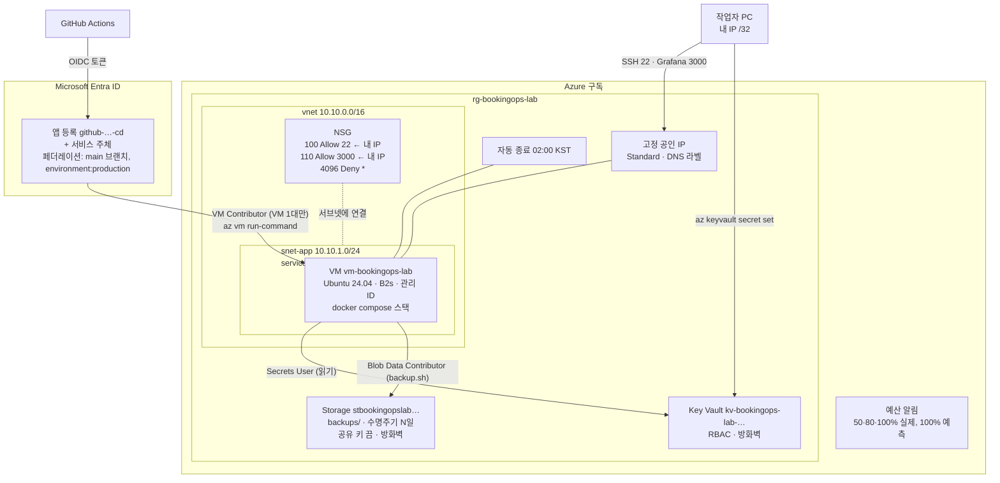

# Azure 인프라 — Terraform 한 줄씩

코드: `infra/terraform/` (파일 12개). 이 문서는 그 코드의 **모든 파일·블록·인자**를 순서대로 설명한다. 면접에서 "이 줄은 왜 있나" 에 답하기 위한 문서다.

**현재 상태 (2026-10-22): 코드 작성 + 정적 검증(fmt · validate · tfsec · checkov · cloud-init schema)까지 끝냈고, 아직 Azure 에 apply 하지 않았다.** 적용 절차는 4절, 검증 기록은 8절.

## 0. 한눈에

| 만드는 것 | 이름 (기본값 기준) | 왜 |
|---|---|---|
| 구독 예산 알림 | `budget-bookingops-lab` | 비용 사고 방지. **가장 먼저** 만든다 |
| 리소스 그룹 | `rg-bookingops-lab` | 전부 담는 그릇. destroy 하면 통째로 사라진다 |
| VNet / 서브넷 | `vnet-bookingops-lab` / `snet-bookingops-lab-app` | VM 이 들어갈 사설망 |
| NSG (규칙 3개) | `nsg-bookingops-lab-app` | 인바운드는 내 IP → 22, 3000 두 개만 |
| 고정 공인 IP + NIC | `pip-…-vm` / `nic-…-vm` | SSH·Grafana 접속, 아웃바운드 인터넷 |
| Linux VM (Ubuntu 24.04, B2s) | `vm-bookingops-lab` | docker compose 로 스택 7개 실행 |
| 자동 종료 스케줄 | (VM 에 붙음) | 매일 02:00 KST 할당 해제. 끄는 걸 잊었을 때의 안전망 |
| Storage 계정 + `backups` 컨테이너 + 수명 주기 정책 | `stbookingopslab<접미사>` | DB 백업 보관, N일 뒤 자동 삭제 |
| Key Vault (RBAC) | `kv-bookingops-lab-<접미사>` | 비밀값 보관. 값은 Terraform 밖에서 넣는다 |
| Entra 앱 등록 + 서비스 주체 + 페더레이션 자격 증명 2개 | `github-bookingops-lab-cd` | GitHub Actions 가 비밀키 없이(OIDC) Azure 로그인 |
| 역할 할당 5개 | — | VM 관리 ID·작업자·GitHub SP 에 필요한 최소 권한 |

원칙 다섯 가지:
1. **예산 먼저, 안 쓸 때 destroy.** 4.2절과 4.8절.
2. **비밀값은 코드에 없다.** Key Vault 에 넣고 VM 의 관리 ID 로 읽는다. 상태 파일에도 비밀값이 없다.
3. **인바운드는 내 IP 두 포트.** 나머지(앱·DB·Prometheus·Alertmanager)는 공인망에 없다.
4. **키 없는 인증.** Storage 공유 키 끔, GitHub 는 OIDC, VM 은 관리 ID, SSH 는 공개키.
5. **모든 값에 validation.** 잘못된 입력은 apply 중간이 아니라 plan 에서 멈춘다.

## 1. 구조도와 생성 순서



생성 순서 (Terraform 이 의존성으로 알아서 정하지만, 사람이 읽는 순서):

1. **예산** (구독 범위, 다른 것에 의존하지 않음 → `-target` 으로 단독 생성 가능)
2. 리소스 그룹 → VNet → 서브넷 → NSG → 규칙 3개 → 서브넷-NSG 연결
3. 공인 IP → NIC → **VM** (관리 ID 가 여기서 생긴다) → 자동 종료 스케줄
4. Storage 계정 → 컨테이너 → 수명 주기 정책 → 역할 할당(VM, 작업자)
5. Key Vault → 역할 할당(VM, 작업자)
6. Entra 앱 등록 → 서비스 주체 → 페더레이션 자격 증명 2개 → VM 에 역할 할당

## 2. 파일별 한 줄씩

### 2.1 `versions.tf` — 버전 고정

```hcl
terraform {
  required_version = ">= 1.9.0, < 2.0.0"
```
Terraform CLI 버전 범위. 1.9 부터 `validation` 블록이 다른 변수를 참조할 수 있다. 2.0 은 호환이 보장되지 않으니 막는다. 없으면: 팀원(또는 미래의 나)이 다른 메이저로 돌려 문법 오류나 상태 파일 형식 불일치를 만난다.

```hcl
  required_providers {
    azurerm = { source = "hashicorp/azurerm", version = "~> 4.81" }
    azuread = { source = "hashicorp/azuread", version = "~> 3.10" }
  }
}
```
- `source`: 레지스트리 주소. 없으면 Terraform 이 `hashicorp/` 를 추정하긴 하지만 명시가 규칙이다.
- `~> 4.81` = `>= 4.81.0, < 5.0.0`. **5.x 가 이미 나와 있다**(2026-10 기준 5.10.0). 메이저 업그레이드는 인자 이름이 바뀌므로 별도 작업으로 뺐다(7절). 4.81.0 이 4.x 의 마지막 마이너라는 것과 3.10.0 이 azuread 최신이라는 것은 레지스트리 API 로 확인했고, `terraform init` 이 그 버전을 실제로 받았다(8절).
- azuread 2.x → 3.x 에서 `application_id` 가 `client_id` 로 바뀌는 등 변경이 있어 3.x 로 고정.
- backend 블록이 없다 = 로컬 상태. 6절.

### 2.2 `providers.tf` — 인증 없음, 삭제 동작 조정

```hcl
provider "azurerm" {
  subscription_id     = var.subscription_id
```
azurerm 4.0 부터 **필수**. 3.x 는 `az login` 의 기본 구독을 썼는데, 엉뚱한 구독에 만드는 사고를 막으려고 4.0 이 명시를 강제했다. 값은 `terraform.tfvars`(커밋 안 함).

```hcl
  storage_use_azuread = true
```
Storage 데이터 평면(컨테이너·블롭)을 계정 키 대신 Entra 토큰으로 호출. `storage.tf` 에서 공유 키를 끄므로 이게 없으면 프로바이더가 키를 가져오려다 실패한다.

```hcl
  features {
    resource_group { prevent_deletion_if_contains_resources = false }
```
`features {}` 는 비어 있어도 필수. 기본값 `true` 는 "Terraform 이 모르는 리소스가 그룹에 있으면 destroy 거부". 운영이면 켜 두는 게 맞지만, 이 랩은 "안 쓸 때 destroy" 가 규칙이라 포털에서 실수로 만든 것이 있어도 그룹째 지워 과금을 끊는다.

```hcl
    key_vault {
      purge_soft_delete_on_destroy    = true
      recover_soft_deleted_key_vaults = true
    }
```
Key Vault 는 지워도 soft-delete 로 7일간 이름이 남는다. destroy 다음 주에 apply 하면 "이름이 이미 있음" 으로 막힌다. 위 두 줄: destroy 때 완전 삭제(purge), 남아 있으면 복구해서 재사용.

```hcl
    virtual_machine { delete_os_disk_on_deletion = true }
  }
}
provider "azuread" {}
```
VM 삭제 시 OS 디스크도 삭제. 기본값도 true 지만 "디스크만 남아 과금" 이 흔해서 명시. azuread 는 az login 세션의 테넌트를 쓰므로 설정이 없다.

### 2.3 `variables.tf` — 입력 전부와 검증

| 변수 | 타입 | 기본 | 검증 | 없거나 틀리면 |
|---|---|---|---|---|
| `subscription_id` | string | (필수) | 소문자 UUID | 4.x 는 provider 가 시작조차 안 됨 |
| `location` | string | `koreacentral` | 소문자만 | 한국에서 가장 가까운 리전. 오타면 plan 에서 멈춤 |
| `project` | string | `bookingops` | `[a-z0-9]{3,12}` | Storage 이름에도 들어가므로 하이픈·대문자 불가 |
| `environment` | string | `lab` | `[a-z0-9]{2,8}` | 이름·태그 |
| `unique_suffix` | string | (필수) | `[a-z0-9]{3,6}` | Storage·Key Vault 는 전 세계 유일 이름. 충돌 시 이 값만 바꾼다 |
| `admin_username` | string | `opsadmin` | 소문자 시작, admin/root 등 금지어 제외 | Azure 가 금지어를 apply 중에 거부한다 → 미리 막음 |
| `ssh_public_key` | string | (필수) | `ssh-rsa` 또는 `ssh-ed25519` 로 시작 | 파일 경로가 아니라 **내용**. Azure 는 RSA ≥2048, Ed25519 지원(ECDSA 불가) |
| `my_ip_cidr` | string | (필수) | IPv4 `/32` | NSG 22·3000 허용 원천. 집 IP 바뀌면 재apply |
| `vm_size` | string | `Standard_B2s` | `Standard_B` 로 시작 | B 시리즈 밖(D·E 등)은 비용 상한을 넘으니 거부 |
| `os_disk_size_gb` | number | 30 | 30~128 | 이미지 최소 30 |
| `vnet_cidr` / `subnet_cidr` | string | `10.10.0.0/16` / `10.10.1.0/24` | CIDR 파싱 | |
| `budget_amount` | number | (필수) | > 0 | **단위는 구독의 청구 통화.** 아래 설명 |
| `budget_start_date` | string | (필수) | `YYYY-MM-01T00:00:00Z` | Azure 규칙: 달의 1일, 이번 달이거나 미래 12개월 이내 |
| `alert_emails` | list(string) | (필수) | 1개 이상, 이메일 형식 | 예산·자동 종료 알림 수신 |
| `github_repository` | string | `rkrsi/booking-ops-lab` | `owner/repo` | OIDC subject 에 들어감. 틀리면 GitHub 로그인 거부 |
| `github_environment` | string | `production` | 1~64자 | `cd.yml` 의 `environment: production` 과 같아야 함 |
| `backup_retention_days` | number | 14 | 1~365 | Blob 수명 주기 |
| `auto_shutdown_enabled` / `auto_shutdown_time` | bool / string | true / `0200` | HHmm | 자동 종료 |
| `tags` | map(string) | {} | | 공통 태그에 merge |

**왜 `vm_size` 기본이 B2s 인가.** 스택이 컨테이너 7개(Postgres, Go 3개, Prometheus, Alertmanager, Grafana)다. 로컬 측정에서 유휴 메모리 합이 1 GiB 를 넘으므로 B1s(1 GiB)는 스왑으로 버티다 OOM 이 난다. B2s 는 2 vCPU · 4 GiB 로 여유가 있고, 버스트형이라 평소 CPU 가 낮은 이 워크로드에 가장 싸다. ARM(B2pts_v2 등)은 더 싸지만 이미지를 multi-arch 로 빌드해야 해서 뺐다.

**왜 `budget_amount` 에 통화가 없나.** Azure 예산 API 는 금액만 받고 통화는 구독의 청구 통화를 따른다. 한국 계정은 보통 KRW 이지만 일부 구독은 USD 다. 포털 **Cost Management > Budgets** 에서 통화를 확인하고 적는다. KRW 구독에 `30000` 은 3만 원, USD 구독에 `30000` 은 3만 달러가 되니 반드시 확인.

**`validation` 을 전부 둔 이유.** Terraform 은 리소스를 하나씩 만든다. 20번째 리소스에서 "이름 규칙 위반" 으로 멈추면 앞의 19개는 만들어진 채 과금된다. 입력 검사는 plan 단계(0원)에서 끝내야 한다.

### 2.4 `locals.tf` — 이름 규칙과 공통 태그

```hcl
prefix = "${var.project}-${var.environment}"       # bookingops-lab
names  = { resource_group = "rg-${local.prefix}", vnet = "vnet-…", … }
```
Azure CAF 권장 접두사(`rg-`, `vnet-`, `snet-`, `nsg-`, `pip-`, `nic-`, `vm-`). 리소스 파일은 `local.names.xxx` 만 쓴다 → 이름 규칙을 한 곳에서 바꾼다.

```hcl
storage_account = "st${var.project}${var.environment}${var.unique_suffix}"
key_vault       = "kv-${local.prefix}-${var.unique_suffix}"
```
Storage 이름은 소문자·숫자 3~24자, 하이픈 불가 — 그래서 접두사 규칙과 다르다. 둘 다 전 세계 유일이라 접미사를 붙인다. 24자 초과는 `storage.tf`·`keyvault.tf` 의 `precondition` 이 plan 에서 잡는다.

```hcl
my_ip = split("/", var.my_ip_cidr)[0]
```
Storage·Key Vault 방화벽의 IP 규칙은 **/31, /32 를 받지 않는다**(프로바이더 문서 확인). 단일 IP 는 접미사 없이 적어야 한다. NSG 는 /32 그대로 쓴다. 이 줄이 없으면 Storage 생성이 apply 중간에 실패한다.

```hcl
common_tags = merge({ project, environment, managed_by = "terraform", repository }, var.tags)
```
비용 분석 필터와 "누가 만들었나" 용. `var.tags` 가 뒤에 있어 사용자 값이 이긴다.

### 2.5 `budget.tf` — 예산 알림

**리소스 그룹 예산이 아니라 구독 예산을 고른 이유.**
- 리소스 그룹 예산은 그 그룹 밖을 못 본다. 포털에서 실수로 다른 그룹에 만든 VM, Azure 가 자동 생성하는 `NetworkWatcherRG` 등.
- 구독 예산은 리소스 그룹에 의존하지 않아 `terraform apply -target=azurerm_consumption_budget_subscription.lab` 으로 **다른 리소스보다 먼저 단독으로** 만들 수 있다. "예산 먼저" 규칙을 코드 구조가 보장한다.
- 예산은 **알림**이지 차단이 아니다. 100% 를 넘어도 Azure 는 아무것도 멈추지 않는다. 멈추는 건 사람(`terraform destroy`).

```hcl
data "azurerm_subscription" "current" {}
```
구독 ID 를 `/subscriptions/<id>` 형식으로 얻는다. `var.subscription_id` 를 문자열로 조립해도 되지만 데이터 소스가 "실제로 접근 가능한 구독인지" 도 확인해 준다.

```hcl
resource "azurerm_consumption_budget_subscription" "lab" {
  name            = local.names.budget
  subscription_id = data.azurerm_subscription.current.id
  amount          = var.budget_amount
  time_grain      = "Monthly"
  time_period { start_date = var.budget_start_date }
```
- `time_grain = "Monthly"`: 매달 1일 집계 초기화. 바꾸면 재생성.
- `start_date`: 반드시 달의 1일. 과거 날짜는 "현재 집계 기간 안" 이어야 하므로 사실상 이번 달 1일. 바꾸면 재생성. `end_date` 생략 = 시작 + 10년.

```hcl
  notification { threshold = 50,  operator = "GreaterThan", threshold_type = "Actual",     contact_emails = var.alert_emails }
  notification { threshold = 80,  … "Actual" }
  notification { threshold = 100, … "Actual" }
  notification { threshold = 100, … "Forecasted" }
```
- `operator = "GreaterThan"`: 사용액이 threshold% 를 **넘는 순간** 한 번 발송. 같은 단계는 그 달에 다시 오지 않는다.
- `Actual` 3단계: 50%(주의) → 80%(이번 주말 destroy 검토) → 100%(즉시 destroy).
- `Forecasted` 100%: "이 추세면 월말에 넘는다" 를 월초에 알려준다. 50% 실제 알림보다 먼저 올 수 있다. 랩에서 가장 유용한 알림이다 — VM 을 켜 둔 채 잊은 지 며칠 안에 온다.
- `contact_emails`: 이메일 직접. Action Group(`contact_groups`)을 쓰면 SMS·웹훅도 되지만 리소스가 하나 더 늘어 뺐다.

### 2.6 `network.tf` — 리소스 그룹, VNet, 서브넷, NSG

```hcl
resource "azurerm_resource_group" "lab" { name, location, tags }
```
모든 리소스의 그릇. 예산(구독)과 Entra 앱(테넌트)만 밖에 있다.

```hcl
resource "azurerm_virtual_network" "lab" { address_space = [var.vnet_cidr] }
resource "azurerm_subnet" "app" {
  address_prefixes  = [var.subnet_cidr]
  service_endpoints = ["Microsoft.Storage", "Microsoft.KeyVault"]
}
```
`service_endpoints`: 이 서브넷에서 Storage·Key Vault 로 가는 트래픽이 Azure 백본을 타고, 두 서비스의 방화벽이 "이 서브넷에서 온 요청" 을 식별한다(`virtual_network_subnet_ids`). **무료.** 사설 엔드포인트(Private Endpoint)는 같은 일을 더 강하게(공인 엔드포인트 자체를 끔) 하지만 월 과금이라 랩에서 뺐다. 이 줄이 없으면 Storage·KV 방화벽에 서브넷을 넣는 apply 가 실패한다.

```hcl
resource "azurerm_network_security_group" "app" {}
```
규칙을 담는 그릇. 규칙은 인라인 `security_rule {}` 대신 별도 리소스로 — plan diff 가 규칙 단위로 보여 리뷰하기 쉽다.

| 규칙 | priority | 방향/동작 | 프로토콜 | 출발지 | 목적지 포트 | 왜 |
|---|---|---|---|---|---|---|
| `AllowSshFromMyIp` | 100 | Inbound Allow | Tcp | `my_ip_cidr` | 22 | 관리 접속. 전 세계 대상 SSH 무차별 대입에서 제외 |
| `AllowGrafanaFromMyIp` | 110 | Inbound Allow | Tcp | `my_ip_cidr` | 3000 | 운영 화면. 로그인이 있어도 공인망에 둘 이유가 없다 |
| `DenyAllInbound` | 4096 | Inbound Deny | * | * | * | 명시적 차단 (아래) |

- `priority`: 작을수록 먼저. 100·110 이 통과시키고 4096 이 나머지를 막는다. 4096 은 사용자 규칙 최댓값.
- `source_port_range = "*"`: 클라이언트 쪽 포트는 임의다. 목적지 포트만 제한하는 게 맞다.
- **명시적 DenyAll 이 왜 필요한가.** Azure 기본 규칙 65500 `DenyAllInBound` 가 이미 있다. 하지만 기본 65000 `AllowVnetInBound`, 65001 `AllowAzureLoadBalancerInBound` 가 그보다 먼저 평가된다. 4096 에 Deny 를 두면 그 둘도 덮어 "열린 건 위 두 개뿐" 이 포털에서도 코드에서도 분명하다. VM 이 한 대라 VNet 내부 허용이 필요 없고, 로드밸런서도 없다.
- **아웃바운드는 건드리지 않는다**(기본 허용). apt, GHCR pull, Anthropic API, Blob 업로드, Key Vault 읽기가 전부 아웃바운드다. `az vm run-command` 도 VM 에이전트의 아웃바운드 채널을 쓴다.
- **공인망에 없는 포트**: 8080(booking-api), 8081(worker), 8082(mock-forwarder), 5432(postgres), 9090(Prometheus), 9093(Alertmanager). 필요하면 `ssh -L 9090:localhost:9090 opsadmin@<vm>` 터널. Docker 가 호스트에 포트를 바인딩해도 NSG 는 VM 밖(가상 NIC)에서 걸리므로 iptables 우회 걱정이 없다.

```hcl
resource "azurerm_subnet_network_security_group_association" "app" { subnet_id, network_security_group_id }
```
NSG 를 NIC 가 아니라 **서브넷**에 건다. VM 이 늘어도 같은 규칙, "NIC 에 붙이는 걸 잊음" 이 없다.

### 2.7 `vm.tf` — 공인 IP, NIC, VM, 자동 종료

```hcl
resource "azurerm_public_ip" "vm" {
  sku               = "Standard"
  allocation_method = "Static"
  ip_version        = "IPv4"
  domain_name_label = "${local.prefix}-${var.unique_suffix}"
}
```
- `Standard`: 기본이 "인바운드 전부 차단, NSG 로만 열기" 라 우리 설계와 맞다. Basic 은 단종 예고(2025-09)가 나 새로 만들면 안 된다.
- `Static`: 껐다 켜도 IP 유지. Dynamic 이면 매번 NSG·DNS·`known_hosts` 가 꼬인다.
- `domain_name_label`: `<label>.koreacentral.cloudapp.azure.com`. 무료. IP 를 외우지 않는다.
- 이 IP 가 VM 의 아웃바운드 SNAT 도 담당한다. Azure 는 "기본 아웃바운드" 를 2025-09 이후 신규 VNet 에서 없앴으므로 공인 IP(또는 NAT Gateway)가 없으면 apt 도 안 된다.

```hcl
resource "azurerm_network_interface" "vm" {
  ip_configuration {
    name                          = "primary"
    subnet_id                     = azurerm_subnet.app.id
    private_ip_address_allocation = "Dynamic"
    public_ip_address_id          = azurerm_public_ip.vm.id
  }
}
```
사설 IP 는 Azure 가 서브넷에서 하나 준다(VM 이 하나라 고정할 이유 없음). 공인 IP 를 여기 붙인다.

```hcl
resource "azurerm_linux_virtual_machine" "app" {
  name = computer_name = local.names.vm
  size = var.vm_size
  network_interface_ids = [azurerm_network_interface.vm.id]
```
`computer_name` 은 OS 안 hostname. 로그·프롬프트에 보인다.

```hcl
  admin_username                  = var.admin_username
  disable_password_authentication = true
  admin_ssh_key { username = var.admin_username, public_key = trimspace(var.ssh_public_key) }
```
비밀번호 로그인 끔 → 무차별 대입 대상 자체가 없다. `trimspace`: 복사할 때 딸려온 줄바꿈이 있으면 Azure 가 키 형식 오류를 낸다.

```hcl
  os_disk {
    name = local.names.os_disk, caching = "ReadWrite"
    storage_account_type = "StandardSSD_LRS"
    disk_size_gb = var.os_disk_size_gb
  }
```
- `StandardSSD_LRS`: Premium 은 랩에 과하고 Standard HDD 는 Postgres·Prometheus 가 체감되게 느리다. LRS = 한 데이터센터 안 3중 복제.
- 30GB: Ubuntu 이미지 최소. 도커 이미지 수백 MB + DB + Prometheus 7일치 + 로그 회전(30MB/컨테이너)으로 충분.

```hcl
  source_image_reference { publisher = "Canonical", offer = "ubuntu-24_04-lts", sku = "server", version = "latest" }
```
URN `Canonical:ubuntu-24_04-lts:server:latest`. Canonical 공식 문서에서 확인한 값(sku `server` = Gen2, `server-gen1` 도 있음). `latest` 는 **만들 때** 최신 패치 이미지를 고르고, 이후 새 이미지가 나와도 VM 을 재생성하지 않는다. 확인 명령: `az vm image list -p Canonical -f ubuntu-24_04-lts --all -o table`.

```hcl
  secure_boot_enabled = true
  vtpm_enabled        = true
```
Trusted Launch. Gen2 이미지 + B 시리즈에서 지원, 추가 비용 없음. 부팅 단계 변조(부트킷)를 막는다. apply 가 "size 가 TrustedLaunch 미지원" 이라고 하면 둘 다 false 로.

```hcl
  identity { type = "SystemAssigned" }
```
VM 의 관리 ID. 이 VM 이 "자기 자신" 으로 Key Vault 를 읽고 Blob 에 쓴다. VM 안에 키 파일·비밀번호가 없고, VM 을 지우면 ID 도 사라진다. 역할 할당은 `storage.tf`·`keyvault.tf` 에서.

```hcl
  custom_data = base64encode(templatefile("${path.module}/cloud-init.yaml", { admin_username, github_repository }))
```
첫 부팅 때 한 번 실행되는 cloud-init(2.8절). `templatefile` 이 두 값을 끼워 넣고 `base64encode` 가 Azure 요구 형식으로 바꾼다. **바꾸면 VM 재생성**(디스크 포함). 바꾸기 전에 `backup.sh`.

```hcl
  boot_diagnostics {}
}
```
빈 블록 = Azure 관리 스토리지 사용. SSH 가 안 될 때 포털 "직렬 콘솔" 과 "부팅 진단" 으로 cloud-init 실패를 본다. 없으면 부팅 문제는 깜깜이다.

```hcl
resource "azurerm_dev_test_global_vm_shutdown_schedule" "app" {
  virtual_machine_id    = azurerm_linux_virtual_machine.app.id
  enabled               = var.auto_shutdown_enabled
  daily_recurrence_time = var.auto_shutdown_time      # "0200"
  timezone              = "Korea Standard Time"       # Windows 시간대 이름 형식
  notification_settings { enabled = true, time_in_minutes = 30, email = var.alert_emails[0] }
}
```
매일 02:00 KST 할당 해제(deallocate). **컴퓨팅 과금이 멈춘다**(디스크·공인 IP 는 계속, 4.8절). "안 쓸 때 destroy" 를 잊었을 때의 안전망. 30분 전 메일(프로바이더 문서가 주소 하나만 받는다고 해서 목록의 첫 번째). 훈련이 길어지면 메일의 링크로 그날만 미룬다. 다음날은 `az vm start -g rg-bookingops-lab -n vm-bookingops-lab`.

### 2.8 `cloud-init.yaml` — 첫 부팅 초기화

실행 로그 `/var/log/cloud-init-output.log`, 상태 `cloud-init status --long`. 스키마는 Ubuntu 24.04 의 `cloud-init schema` 로 검증했다(8절).

| 항목 | 값 | 왜 |
|---|---|---|
| `package_update` / `package_upgrade` | true / true | 보안 패치를 전부 적용하고 시작. 첫 부팅이 몇 분 느려지지만 알려진 취약점을 안고 서비스를 올리지 않는다 |
| `packages` | ca-certificates, curl, gnupg, git, **chrony**, jq | chrony: 로컬 훈련에서 시계가 5시간 40분 어긋나 그래프가 비었던 일(`docs/ai-usage.md`). `healthcheck.sh` 가 `chronyc tracking` 을 점검한다. jq: 스크립트의 JSON 처리 |
| `ssh_pwauth: false` | | `disable_password_authentication` 과 이중 잠금 |
| `write_files` → `/etc/docker/daemon.json` | json-file, 10m × 3 | **컨테이너 로그 회전.** 로그가 무한히 쌓여 디스크를 채우는 것(장애 훈련 6번)을 기본 설정에서 막는다 |
| `runcmd` 1~4 | Docker 공식 apt 저장소 등록 | Ubuntu 기본 `docker.io` 는 버전이 오래되고 compose 플러그인이 없다. 서명키를 `/etc/apt/keyrings` 에 두고 `signed-by` 로 그 저장소에만 쓴다. 코드네임 `noble` 고정: 이미지를 24.04 로 고정했으니 동적 조회가 필요 없다 |
| `runcmd` 5~7 | Microsoft apt 저장소 → `azure-cli` | VM 이 관리 ID 로 `az login --identity` → Key Vault 읽기(.env 생성), `az storage blob upload --auth-mode login`(backup.sh) |
| `runcmd` 8~9 | `apt-get install docker-ce … docker-compose-plugin azure-cli` | `DEBIAN_FRONTEND=noninteractive`: 무인 설치에서 프롬프트로 멈추지 않게 |
| `usermod -aG docker <admin>` | | sudo 없이 docker. docker 그룹 = 사실상 root 라 이 계정 하나에만 |
| `systemctl enable --now docker`, `chrony` | | 재부팅 후에도 자동 시작 |
| `git clone --depth 1 … /opt/booking-ops-lab` + `chown` | | compose 파일·모니터링 설정이 저장소에 있다. 공개 저장소라 인증 없음. 비공개면 이 줄만 실패하고 앞의 설치는 유지된다(runcmd 는 실패해도 다음 줄을 계속 실행). 맨 뒤에 둔 이유 |
| `final_message` | `$UPTIME` | cloud-init 자체 치환. 부팅 진단 콘솔에서 완료 여부를 한 줄로 |

**.env 는 여기서 만들지 않는다.** 비밀값이 cloud-init(= VM 메타데이터에 평문 저장)에 들어가면 안 된다. 4.5절에서 관리 ID 로 Key Vault 를 읽어 만든다.

템플릿 주의: Terraform `templatefile` 은 **주석 안의 `${…}` 도 해석**한다. 작성 중 주석에 그 표기를 썼다가 validate 가 깨졌다(8절, `docs/ai-usage.md`).

### 2.9 `storage.tf` — 백업 Storage

```hcl
resource "azurerm_storage_account" "backups" {
  account_kind = "StorageV2"  account_tier = "Standard"  account_replication_type = "LRS"
```
- `StorageV2`: 수명 주기 정책이 v2 에서만 된다.
- `Standard`(HDD): 백업 파일 쓰기/가끔 읽기에 충분.
- `LRS`: 한 데이터센터 안 3중 복제. GRS(다른 리전 복제)는 2배 비용인데 랩 백업엔 과하다. checkov 가 지적(5.3절).
- 액세스 계층 기본 Hot. Cool 은 저장 단가가 싸지만 **30일 안에 지우면 위약금** — 14일 보관 백업엔 Hot 이 오히려 싸다.

```hcl
  https_traffic_only_enabled      = true
  min_tls_version                 = "TLS1_2"
  allow_nested_items_to_be_public = false
```
http 거부, TLS 1.0/1.1 거부. 세 번째: 컨테이너·블롭을 "익명 공개" 로 설정하는 것 자체를 계정에서 금지 → 백업을 실수로 공개하는 길이 없다.

```hcl
  shared_access_key_enabled       = false
  default_to_oauth_authentication = true
```
**계정 키·SAS 접근 끔.** 유출될 키가 없다. 트레이드오프: `az storage blob …` 에 `--auth-mode login` 을 붙여야 하고, 구독 Owner 라도 **데이터 평면 역할**(아래 역할 할당)이 없으면 403. 포털도 키 모드로 열면 403 이라 기본을 Entra 인증으로(`default_to_oauth_authentication`). `backup.sh`·`restore.sh` 는 이미 `--auth-mode login` 을 쓴다.

```hcl
  public_network_access_enabled = true
  network_rules {
    default_action             = "Deny"
    bypass                     = ["AzureServices"]
    ip_rules                   = [local.my_ip]
    virtual_network_subnet_ids = [azurerm_subnet.app.id]
  }
```
공인 엔드포인트는 두되(사설 엔드포인트는 유료) 방화벽으로 **VM 서브넷 + 내 IP** 만. `bypass AzureServices`: Azure 플랫폼 서비스는 통과(지금 쓰는 건 없지만, 막아 두면 나중에 원인 찾기 어렵다). `ip_rules` 에 /32 를 쓰면 거부되므로 `local.my_ip`.

```hcl
  blob_properties {
    delete_retention_policy           { days = 7 }
    container_delete_retention_policy { days = 7 }
  }
  lifecycle { precondition { condition = length(local.names.storage_account) <= 24 … } }
}
```
소프트 삭제 7일: prune 스크립트 버그나 실수로 지운 백업을 되살릴 수 있다. 수명 주기로 지운 것도 7일 더 남는다(소량이라 비용 무시). `precondition`: 이름 24자 초과를 plan 에서 멈춘다.

```hcl
resource "azurerm_storage_container" "backups" {
  name = "backups"  storage_account_id = azurerm_storage_account.backups.id  container_access_type = "private"
}
```
`storage_account_id`(4.x 신규)를 쓰면 프로바이더가 데이터 평면이 아니라 **Resource Manager API** 로 만든다 → 공유 키를 꺼 둔 상태에서 문제없다. `storage_account_name` 은 deprecated. 이름 `backups` 는 `backup.sh` 의 `BACKUP_CONTAINER` 기본값과 같다.

```hcl
resource "azurerm_storage_management_policy" "backups" {
  rule {
    name = "delete-old-backups"  enabled = true
    filters { blob_types = ["blockBlob"], prefix_match = ["backups/"] }
    actions { base_blob { delete_after_days_since_modification_greater_than = var.backup_retention_days } }
  }
}
```
"보관 기간 지난 백업 정리" 를 스크립트가 아니라 **Azure 가** 한다. 스크립트가 죽어도, VM 이 사라져도 정리는 계속된다. `prefix_match "backups/"` = 그 컨테이너 전체. (`backup.sh` 의 `BACKUP_RETENTION_DAYS` 는 **VM 로컬 파일** 보관 일수다. 둘은 다른 값이어도 된다.)

```hcl
resource "azurerm_role_assignment" "vm_blob_contributor" {
  scope = azurerm_storage_account.backups.id
  role_definition_name = "Storage Blob Data Contributor"
  principal_id = azurerm_linux_virtual_machine.app.identity[0].principal_id
  principal_type = "ServicePrincipal"
}
resource "azurerm_role_assignment" "operator_blob_contributor" { … principal_id = data.azurerm_client_config.current.object_id, principal_type = "User" }
```
- VM 관리 ID → **이 계정 하나**에서 블롭 읽기·쓰기·삭제. 데이터 평면 역할이라 계정 설정(방화벽·키)은 못 건드린다.
- 작업자(지금 `az login` 한 사람) → 같은 역할. 복구 훈련 때 백업을 내려받고 테스트 파일을 지우기 위해. Owner 라도 이게 없으면 블롭을 못 본다.
- `principal_type` 명시: 방금 만든 ID 를 Entra 가 아직 복제 못 해 "PrincipalNotFound" 가 나는 경쟁을 줄인다.

### 2.10 `keyvault.tf` — 비밀값 저장소

```hcl
data "azurerm_client_config" "current" {}
```
terraform 을 실행 중인 주체의 `tenant_id`, `object_id`, `subscription_id`. 역할 할당과 출력에 쓴다.

```hcl
resource "azurerm_key_vault" "lab" {
  tenant_id = data.azurerm_client_config.current.tenant_id
  sku_name  = "standard"
  rbac_authorization_enabled = true
```
- `standard`: premium 은 HSM 키용. 비밀값 몇 개엔 standard.
- `rbac_authorization_enabled`: 접근 정책(access policy) 대신 Azure RBAC. Storage 와 같은 방식(역할 할당)이라 권한 표(5.1절)가 한 종류로 읽힌다. 4.0 에서 `enable_rbac_authorization` 에서 이름이 바뀐 인자.

```hcl
  soft_delete_retention_days = 7
  purge_protection_enabled   = false
```
- 7 = 최솟값. 길면 destroy 뒤 이름 재사용이 그만큼 막힌다(providers.tf 의 purge 옵션으로 보완).
- **퍼지 보호 끔.** 켜면 soft-delete 된 볼트를 보존 기간 동안 아무도(Owner 도) 완전 삭제 못 한다. **운영이면 켜야 맞다.** 이 랩은 "destroy → 다음 주 apply" 가 전제라 켜면 7일간 이름이 잠긴다. tfsec `azure-keyvault-no-purge`, checkov `CKV_AZURE_42/110` 이 지적하며, 알고 수용한 항목이다(5.3절).

```hcl
  public_network_access_enabled = true
  network_acls { default_action = "Deny", bypass = "AzureServices", ip_rules = [local.my_ip], virtual_network_subnet_ids = [azurerm_subnet.app.id] }
  lifecycle { precondition { … length(local.names.key_vault) <= 24 … } }
}
```
Storage 와 같은 모델. 방화벽은 **데이터 평면**(비밀 읽기/쓰기)에만 걸리고 Terraform 의 볼트 생성·설정 변경(Resource Manager)은 영향 없다. 작업자는 내 IP 에서 `az keyvault secret set`, VM 은 서브넷에서 읽기.

```hcl
resource "azurerm_role_assignment" "vm_kv_secrets_user"          { role = "Key Vault Secrets User",    principal = VM 관리 ID }
resource "azurerm_role_assignment" "operator_kv_secrets_officer" { role = "Key Vault Secrets Officer", principal = 작업자 }
```
VM 은 **읽기만**(User). 작업자는 생성·수정·삭제(Officer). 구독 Owner 여도 RBAC 볼트의 비밀은 이 역할 없이는 못 만든다. 역할 전파에 최대 10분 — apply 직후 `secret set` 이 403 이면 잠시 뒤 다시.

**비밀값을 Terraform 에 넣지 않는 이유.** `azurerm_key_vault_secret` 으로 넣으면 값이 **상태 파일에 평문**으로 남는다. 로컬 상태는 gitignore 지만, 상태를 원격으로 옮기는 순간(6절) 그 저장소가 비밀 저장소가 된다. 값은 4.4절처럼 az cli 로 넣는다.

### 2.11 `github-oidc.tf` — GitHub Actions 의 비밀키 없는 로그인

흐름: 워크플로가 GitHub 에서 **짧은 수명의 OIDC 토큰**을 받는다 → `azure/login` 이 그 토큰을 Entra 에 제시 → Entra 가 토큰의 `issuer` 와 `subject` 를 아래 페더레이션 자격 증명과 대조 → 맞으면 이 앱의 Azure 토큰 발급. **GitHub Secrets 에 저장할 비밀키가 없다**(client secret 만료·유출·회전 문제가 통째로 사라진다).

```hcl
resource "azuread_application" "cd"       { display_name = local.names.github_app, description }
resource "azuread_service_principal" "cd" { client_id = azuread_application.cd.client_id }
```
- 앱 등록 = 테넌트 안 "애플리케이션" 정의. `client_id` 가 GitHub secret `AZURE_CLIENT_ID`.
- 서비스 주체 = 그 앱이 **이 테넌트에서 권한을 받을 수 있는 주체**. 역할 할당은 SP 의 `object_id` 에 건다. (3.x 에서 `application_id` → `client_id`.)

```hcl
resource "azuread_application_federated_identity_credential" "main_branch" {
  application_id = azuread_application.cd.id
  audiences      = ["api://AzureADTokenExchange"]
  issuer         = "https://token.actions.githubusercontent.com"
  subject        = "repo:${var.github_repository}:ref:refs/heads/main"
}
resource "azuread_application_federated_identity_credential" "production_environment" {
  … subject = "repo:${var.github_repository}:environment:${var.github_environment}"
}
```
- `application_id`: 앱 등록의 **리소스 ID**(`/applications/<object-id>`). 3.x 에서 `application_object_id` 에서 바뀐 인자(프로바이더 문서 확인).
- `audiences`: Entra 가 요구하는 고정값. `issuer`: GitHub 의 토큰 발급자. 둘 중 하나라도 다르면 거부.
- **subject 두 개가 필요한 이유.** GitHub 은 job 에 `environment:` 가 없으면 `repo:<owner/repo>:ref:refs/heads/<branch>` 를, 있으면 `repo:<owner/repo>:environment:<name>` 을 subject 로 넣는다. `cd.yml` 의 deploy job 은 `environment: production` 을 쓰므로 두 번째가 실제로 쓰이고, 첫 번째는 환경 없는 job(향후 검증용 등)을 위한 것이다. 다른 브랜치·PR·포크에서 온 토큰은 subject 가 달라 **로그인 자체가 거부**된다.

```hcl
resource "azurerm_role_assignment" "cd_vm_contributor" {
  scope                = azurerm_linux_virtual_machine.app.id
  role_definition_name = "Virtual Machine Contributor"
  principal_id         = azuread_service_principal.cd.object_id
  principal_type       = "ServicePrincipal"
}
```
- 범위가 **VM 리소스 하나**. 리소스 그룹의 Storage·Key Vault 는 보이지도 않는다. 리소스 그룹 Reader 도 주지 않았다(`az vm run-command invoke -g <rg> -n <vm>` 은 VM 범위 권한만으로 된다).
- CD 는 `az vm run-command invoke` 로 VM 안에서 `scripts/deploy.sh` 를 실행한다. 이 명령은 VM 에이전트의 아웃바운드 채널을 타므로 **GitHub 러너에 SSH 를 열 필요가 없다**(NSG 22 는 내 IP 만 유지). VM Contributor 가 `runCommand/action` 을 포함한다.
- 더 좁히기: `Microsoft.Compute/virtualMachines/read` + `runCommand/action` 두 개만 가진 사용자 지정 역할. 7절.

### 2.12 `outputs.tf`

| 출력 | 어디에 쓰나 |
|---|---|
| `resource_group_name`, `vm_name` | GitHub **variables** `AZURE_RESOURCE_GROUP`, `AZURE_VM_NAME` (cd.yml 이 읽는 이름 그대로) |
| `public_ip`, `public_fqdn`, `ssh_command`, `grafana_url` | 접속 |
| `storage_account_name`, `backup_container_name` | VM `.env` 의 `BACKUP_STORAGE_ACCOUNT`, `BACKUP_CONTAINER` |
| `key_vault_name`, `key_vault_uri` | `az keyvault secret set --vault-name` |
| `vm_identity_principal_id` | 역할 전파 문제 조사 |
| `github_secret_AZURE_CLIENT_ID` / `_TENANT_ID` / `_SUBSCRIPTION_ID` | GitHub **secrets** 이름 그대로 |

비밀값은 없다. 구독·테넌트 ID 는 비밀은 아니지만 공개 저장소·스크린샷에 올리지 않는다(공격 표면 정보).

### 2.13 `terraform.tfvars.example`, `.gitignore`, `.terraform.lock.hcl`

- `terraform.tfvars.example`: 자리표시자만(`00000000-…`, `203.0.113.10/32`, `ops@example.com`). `cp` 해서 `terraform.tfvars` 를 만들고, 그 파일은 커밋하지 않는다.
- `.gitignore` 추가분: `.terraform/`(플러그인 캐시, 수십 MB), `*.tfstate`·`*.tfstate.*`(**상태 파일 — 리소스 ID·설정·공개키가 평문**), `*.tfvars`(구독 ID·내 IP·이메일), `!*.tfvars.example`, `*.tfplan`(plan 파일도 상태만큼 민감), `crash.log`.
- **`.terraform.lock.hcl` 은 커밋한다.** `init` 이 고른 프로바이더의 정확한 버전과 체크섬(linux/windows/macOS 4개 플랫폼)이 들어 있다. 이게 있어야 다른 PC·CI 에서 `init` 해도 **같은 4.81.0** 을 받고, 레지스트리에서 바뀐 바이너리를 받으면 체크섬 불일치로 멈춘다. 공급망 방어선이자 재현성 보장. 버전 올릴 때만 `terraform init -upgrade` 로 갱신하고 diff 를 리뷰한다.

## 3. 비용 추정

**근사치다.** 가격은 리전·시점·환율에 따라 다르다. apply 전에 [Azure 가격 계산기](https://azure.microsoft.com/pricing/calculator/) 에서 `Korea Central` 로 확인하고, apply 후에는 Cost Management 에서 실측을 README 에 적는다. 아래는 2026-10 시점 종량제(pay-as-you-go) 공개 단가의 자릿수 수준 추정, USD 기준(1 USD ≈ 1,400 KRW 가정).

| 항목 | 단가 (근사) | 24시간 켜 둘 때 / 월 | 비고 |
|---|---|---|---|
| VM Standard_B2s | $0.04~0.06 / h | **$30~45** | 켠 시간만 과금. 할당 해제(deallocate) 시 0 |
| OS 디스크 StandardSSD_LRS 30GB | | $2~3 | VM 을 꺼도 과금 |
| 고정 공인 IP (Standard) | $0.004~0.005 / h | $3~4 | VM 을 꺼도 과금 |
| Storage LRS Hot (백업 수십 MB + 요청 수천) | | < $1 | |
| Key Vault standard (요청 수백) | $0.03 / 1만 요청 | < $1 | |
| 아웃바운드 트래픽 | 월 100GB 무료 | ≈ 0 | GHCR pull 수백 MB 수준 |
| 예산, NSG, VNet, 서비스 엔드포인트, 자동 종료, 부팅 진단(관리형), Entra 앱, 역할 할당 | 무료 | 0 | |
| **합계 (24시간)** | | **≈ $36~55 (≈ 5~8만 원)** | |
| **금·토·일만 켬 (≈ 40%)** | | **≈ $18~25** | 자동 종료 02:00 + 필요할 때 `az vm start` |
| **VM 할당 해제만 한 상태** | | ≈ $5~7 | 디스크 + IP. 데이터 유지 |
| **`terraform destroy` 후** | | **0** | 예산·Entra 앱만 남아도 무료 |

운영 규칙: **작업 끝나면 최소 `az vm deallocate`, 주말 끝나면 destroy(4.8절). 예산 `budget_amount` 는 "24시간 합계" 보다 조금 위**로 잡아 Forecasted 100% 알림이 "켜 둔 채 잊음" 을 며칠 안에 잡게 한다.

## 4. 적용 절차 (작업자용 runbook)

전제: Azure 구독의 **Owner**(역할 할당에 필요), 테넌트에서 앱 등록 생성 가능(개인 테넌트 기본값), 로컬에 `az`·`terraform`(1.9+)·`ssh-keygen`. 모든 명령은 `infra/terraform/` 에서.

### 4.1 준비

```bash
az login
az account list -o table                      # 구독이 여러 개면
az account set --subscription <구독 ID>
az account show --query '{name:name,id:id,tenant:tenantId}' -o table
ssh-keygen -t ed25519 -f ~/.ssh/booking-ops-lab -C "ops@example.com"   # 전용 키. 비밀키는 PC 밖으로 안 나간다
curl -4 -s ifconfig.me                        # 내 공인 IP
cp terraform.tfvars.example terraform.tfvars  # 채운다: subscription_id, unique_suffix, ssh_public_key(= cat ~/.ssh/booking-ops-lab.pub), my_ip_cidr, budget_amount, budget_start_date(이번 달 1일), alert_emails
terraform init                                # 잠금 파일 그대로 4.81.0 / 3.10.0 을 받는다
terraform fmt -check && terraform validate
```
`budget_amount` 전에 포털 Cost Management > Budgets 에서 **통화**를 확인한다.

### 4.2 예산 먼저

```bash
terraform plan  -target=azurerm_consumption_budget_subscription.lab
terraform apply -target=azurerm_consumption_budget_subscription.lab
```
plan 에 리소스 **1개**(예산)만 나와야 한다. 포털 Cost Management > Budgets 에서 `budget-bookingops-lab` 과 알림 4개를 확인한 뒤 다음으로. `-target` 은 Terraform 이 "부분 적용" 경고를 내는데, 이 단계에서는 의도한 것이다.

### 4.3 전체 apply

```bash
terraform plan -out=plan.tfplan     # 예산 제외 약 25개 생성 예정. 삭제(destroy)가 0 인지 확인
terraform apply plan.tfplan         # 5~8분. VM 생성 후 cloud-init 은 별도로 5~10분 더 돈다
terraform output                    # 아래 단계에서 쓰는 값들
```
`plan.tfplan` 은 gitignore 대상. 흔한 실패: 4.9절.

### 4.4 Key Vault 에 비밀 넣기 (Terraform 밖)

```bash
KV=$(terraform output -raw key_vault_name)
setkv() { local v; read -rs -p "$1: " v; echo; az keyvault secret set --vault-name "$KV" --name "$1" --value "$v" -o none; }
setkv postgres-password          # 예: openssl rand -base64 24 로 만든 값
setkv grafana-admin-password
setkv anthropic-api-key
setkv discord-webhook-url
az keyvault secret list --vault-name "$KV" --query '[].name' -o tsv
```
`read -rs` 로 받아 **셸 히스토리에 값이 남지 않게** 한다. 403 이면 역할 전파 대기(최대 10분) 또는 `my_ip_cidr` 가 지금 IP 와 다른 것.

| 비밀 이름 (Key Vault) | → `.env` 변수 | 출처 |
|---|---|---|
| `postgres-password` | `POSTGRES_PASSWORD` | 새로 생성 |
| `grafana-admin-password` | `GRAFANA_ADMIN_PASSWORD` | 새로 생성 |
| `anthropic-api-key` | `ANTHROPIC_API_KEY` | Anthropic 콘솔 |
| `discord-webhook-url` | `DISCORD_WEBHOOK_URL` | Discord 채널 설정 |

### 4.5 VM 에서 `.env` 만들기 (관리 ID 로 Key Vault 읽기)

`scripts/deploy.sh` 는 `.env` 의 `IMAGE_TAG` 만 바꾸고 `.env` 를 만들지는 않는다. 첫 1회는 사람이 만든다.

```bash
ssh -i ~/.ssh/booking-ops-lab $(terraform output -raw ssh_command | cut -d' ' -f2)
cloud-init status --wait && tail -3 /var/log/cloud-init-output.log     # "finished after N seconds"
docker --version && docker compose version && chronyc tracking | head -3
az login --identity --allow-no-subscriptions -o none                   # VM 관리 ID. 비밀번호 없음
KV=kv-bookingops-lab-<접미사>                                           # terraform output key_vault_name
kv() { az keyvault secret show --vault-name "$KV" --name "$1" --query value -o tsv; }
umask 077
{
  echo "POSTGRES_USER=booking"
  echo "POSTGRES_PASSWORD=$(kv postgres-password)"
  echo "POSTGRES_DB=booking"
  echo "ANTHROPIC_API_KEY=$(kv anthropic-api-key)"
  echo "GRAFANA_ADMIN_PASSWORD=$(kv grafana-admin-password)"
  echo "DISCORD_WEBHOOK_URL=$(kv discord-webhook-url)"
  echo "BACKUP_STORAGE_ACCOUNT=<terraform output storage_account_name>"
  echo "BACKUP_CONTAINER=backups"
  echo "IMAGE_TAG=<배포할 커밋 SHA>"
} > /opt/booking-ops-lab/.env
ls -l /opt/booking-ops-lab/.env            # -rw------- 여야 한다
```
`--allow-no-subscriptions`: VM 관리 ID 는 구독 수준 역할이 없어(데이터 평면 역할만) 이 옵션이 없으면 로그인이 경고로 끝난다. 이 절차를 스크립트로 만드는 것은 7절.

### 4.6 GitHub 설정

| 종류 | 이름 | 값 |
|---|---|---|
| secret | `AZURE_CLIENT_ID` | `terraform output -raw github_secret_AZURE_CLIENT_ID` |
| secret | `AZURE_TENANT_ID` | `terraform output -raw github_secret_AZURE_TENANT_ID` |
| secret | `AZURE_SUBSCRIPTION_ID` | `terraform output -raw github_secret_AZURE_SUBSCRIPTION_ID` |
| variable | `AZURE_RESOURCE_GROUP` | `terraform output -raw resource_group_name` |
| variable | `AZURE_VM_NAME` | `terraform output -raw vm_name` |
| environment | `production` | Settings > Environments 에서 생성. 보호 규칙(승인자)은 선택 |

세 ID 는 엄밀히 비밀이 아니지만 secrets 에 두면 로그에서 마스킹된다. **비밀키(client secret)는 없다** — 페더레이션 자격 증명이 대신한다.

### 4.7 확인

```bash
# 내 PC 에서
terraform output public_fqdn
ssh -i ~/.ssh/booking-ops-lab opsadmin@<fqdn> 'sudo cloud-init status'               # done
az vm run-command invoke -g rg-bookingops-lab -n vm-bookingops-lab --command-id RunShellScript --scripts 'echo run-command-ok'
az storage blob list --auth-mode login --account-name <storage> --container-name backups -o table   # 비어 있어도 403 이 아니면 성공
# 다른 네트워크(휴대폰 테더링)에서: ssh 와 :3000 이 타임아웃이어야 정상
# VM 안에서
scripts/healthcheck.sh                        # time sync (chrony) OK 포함
BACKUP_TARGET=azure BACKUP_STORAGE_ACCOUNT=<storage> scripts/backup.sh
# GitHub: Actions > CD > Run workflow → deploy job 의 azure/login 이 통과하면 OIDC 완성
```

### 4.8 끄기와 지우기 — 세 단계

| 상황 | 명령 | 남는 과금 | 데이터 |
|---|---|---|---|
| 오늘 끝, 내일 계속 | `az vm deallocate -g rg-bookingops-lab -n vm-bookingops-lab` (02:00 자동 종료가 같은 일을 한다) | 디스크 + IP ≈ $5~7/월 | 전부 유지 |
| 이번 주 끝, 다음 주 계속 | `terraform destroy -target=azurerm_linux_virtual_machine.app` | IP ≈ $3/월 + Storage·KV < $1 | **VM·디스크 삭제**(DB 볼륨 소실). 백업(Storage)·비밀(KV)·네트워크·Entra 앱 유지. 재apply 시 VM + cloud-init + 4.5절 `.env` 다시. 복구 훈련(5번)과 묶으면 자연스럽다 |
| 프로젝트 종료 / 장기 중단 | `terraform destroy` | 0 | **전부 삭제. 백업도 사라진다** — 필요하면 먼저 내려받기. Entra 앱이 재생성되므로 다음 apply 뒤 GitHub secret `AZURE_CLIENT_ID` 갱신 |

destroy 뒤 `az group list -o table` 로 남은 그룹을 확인한다(`NetworkWatcherRG` 는 Azure 자동 생성, 무료). `terraform destroy -target` 은 대상에 **의존하는 것**(VM 의 역할 할당 3개, 자동 종료 스케줄)도 같이 지운다 — 의도된 동작.

### 4.9 흔한 오류

| 증상 | 원인 | 조치 |
|---|---|---|
| `MissingSubscriptionRegistration: Microsoft.Consumption` (또는 DevTestLab) | 구독에 리소스 공급자 미등록 | `az provider register -n Microsoft.Consumption` (또는 `Microsoft.DevTestLab`), 2~3분 뒤 재시도 |
| `StorageAccountAlreadyTaken` / Key Vault 이름 충돌 | 전 세계 유일 이름 충돌 | `unique_suffix` 변경 |
| `PrincipalNotFound` (역할 할당) | 방금 만든 ID 복제 지연 | 1~2분 뒤 `terraform apply` 재실행(멱등) |
| `az keyvault secret set` 403 | 역할 전파 대기 또는 IP 불일치 | 10분 대기 / `curl -4 ifconfig.me` 로 IP 확인 후 `my_ip_cidr` 수정·apply |
| SSH 타임아웃 | 내 IP 변경 | 위와 같음. 임시로는 포털 직렬 콘솔 |
| `cloud-init status` 가 `error` | apt 저장소·네트워크 | `/var/log/cloud-init-output.log`. 대개 재부팅이 아니라 `sudo cloud-init clean && sudo reboot` 로 재실행 |
| Key Vault "이름이 soft-deleted 상태" | 이전 destroy 가 purge 못 함 | `az keyvault purge --name <kv>` 후 apply |
| apply 가 Trusted Launch 미지원 | 크기·이미지 조합 | `secure_boot_enabled`/`vtpm_enabled` false |

## 5. 보안 검토

### 5.1 최소 권한 표 (주체 → 역할 → 범위)

| 주체 | 역할 | 범위 | 왜 이만큼만 |
|---|---|---|---|
| 작업자 (`az login` 사용자) | Owner (구독 기본) | 구독 | Terraform 실행·역할 할당. 사람 1명, MFA |
| 작업자 | Key Vault Secrets Officer | Key Vault 1개 | 비밀 생성·회전. Owner 로는 데이터 평면 불가 |
| 작업자 | Storage Blob Data Contributor | Storage 1개 | 백업 확인·다운로드·테스트 파일 삭제 |
| VM 관리 ID | Key Vault Secrets User | Key Vault 1개 | `.env` 생성 시 **읽기만** |
| VM 관리 ID | Storage Blob Data Contributor | Storage 1개 | `backup.sh` 업로드. 다른 Storage·리소스 그룹 접근 불가 |
| GitHub Actions SP (OIDC) | Virtual Machine Contributor | **VM 1대** | `az vm run-command`. Storage·KV·RG 는 보이지 않음. 비밀키 없음 |
| GitHub Actions SP | (없음) | 구독·리소스 그룹 | Reader 조차 주지 않음 |
| 인터넷 | — | — | 22·3000 은 내 IP /32 만. 나머지 Deny |

### 5.2 경계 요약

| 경계 | 통제 |
|---|---|
| 네트워크 인바운드 | NSG 3규칙. 앱·DB·모니터링 포트 미노출. 서브넷 단위 적용 |
| 네트워크 아웃바운드 | 기본 허용(apt·GHCR·Anthropic·Blob). 제한은 7절 |
| Storage | 공유 키 끔, HTTPS·TLS1.2, 익명 공개 금지, 방화벽(서브넷+내 IP), 소프트 삭제 7일 |
| Key Vault | RBAC, 방화벽(서브넷+내 IP), 값은 상태 파일 밖 |
| VM | SSH 키만, Trusted Launch, 관리 ID(키 파일 없음), 보안 패치 후 시작, 로그 회전 |
| CI/CD | OIDC(비밀키 없음), subject 로 저장소·브랜치·환경 고정, VM 1대 범위 |
| 코드 | 비밀값·실제 ID 없음. tfvars·state 는 gitignore. 잠금 파일로 프로바이더 체크섬 고정 |

### 5.3 정적 스캐너 결과와 수용 항목

tfsec v1.28.14: **14 passed, 1 medium.** checkov: **42 passed, 11 failed.** 전부 아래와 같이 판단했고, 고칠 것은 없었다(설계상 선택). 운영 환경이면 "수용" 대부분을 다시 켜야 한다.

| 도구 / 항목 | 내용 | 판단 | 이유 |
|---|---|---|---|
| tfsec `azure-keyvault-no-purge`, checkov `CKV_AZURE_42`, `CKV_AZURE_110` | Key Vault 퍼지 보호 끔 | **수용** | 2.10절. destroy↔apply 반복하는 랩. 운영이면 켠다 |
| checkov `CKV_AZURE_59`, `CKV2_AZURE_33`, `CKV2_AZURE_32` | Storage·Key Vault 공인 접근 켬 / 사설 엔드포인트 없음 | **수용** | 방화벽(서브넷 서비스 엔드포인트 + 내 IP, 기본 Deny)으로 대체. 사설 엔드포인트는 월 과금 |
| checkov `CKV_AZURE_206` | Storage 가 LRS | **수용** | 14일 보관 랩 백업. 비용 2배짜리 GRS 불필요 |
| checkov `CKV_AZURE_33`, `CKV2_AZURE_21` | Storage 큐/블롭 요청 로깅 없음 | **수용 (후속)** | 큐는 쓰지 않음. 블롭 접근 로그는 Log Analytics 가 필요해 7절로 |
| checkov `CKV2_AZURE_1` | 고객 관리 키(CMK) 암호화 아님 | **수용** | Microsoft 관리 키로 저장 시 암호화는 이미 됨. CMK 는 키 관리 부담만 늘림 |
| checkov `CKV_AZURE_50` | VM 확장(extension) 작업 허용 | **수용** | `az vm run-command`(CD) 가 에이전트 확장 채널을 쓴다. 끄면 배포가 안 됨 |
| checkov `CKV_AZURE_119` | NIC 에 공인 IP | **수용** | 단일 VM, Bastion(월 $140+)·NAT Gateway 없이 접속하려면 필요. 22 는 내 IP 만 |

## 6. 상태 파일 — 지금(로컬)과 다음(원격)

지금은 `infra/terraform/terraform.tfstate` 로컬 파일. 위험:
- **분실 = 고아 리소스.** PC 가 죽으면 Terraform 이 리소스를 모른다. 포털에서 손으로 지우거나 `terraform import` 로 하나씩 되찾아야 한다.
- **잠금 없음.** 두 터미널에서 동시에 apply 하면 상태가 깨진다(1인이라 당장은 괜찮다).
- **내용이 민감.** 리소스 ID, 공개키, 내 IP, 이메일, 구독 ID. gitignore 는 했지만 백업 위치를 정해야 한다.

다음 단계 — `azurerm` backend:
```hcl
terraform {
  backend "azurerm" {
    resource_group_name  = "rg-bookingops-tfstate"
    storage_account_name = "stbookingopstfstate<접미사>"
    container_name       = "tfstate"
    key                  = "lab.tfstate"
    use_azuread_auth     = true   # 공유 키 없이
  }
}
```
**부트스트랩 문제**: 상태를 담을 Storage 가 Terraform 이전에 있어야 한다. 해결은 (a) `az storage account create` 한 번으로 손으로 만들고 README 에 명령을 남기거나, (b) `infra/terraform-bootstrap/` 이라는 **별도 루트**(자기 상태는 로컬)로 만든다. 이 Storage 는 `destroy` 대상이 아니어야 하므로 **다른 리소스 그룹**에 둔다. 블롭 임대(lease)가 잠금 역할을 한다. 옮길 때는 `terraform init -migrate-state`.

## 7. 아직 안 한 것 (우선순위 순)

1. **원격 상태**(6절).
2. **`.env` 생성 자동화**: 4.5절을 `scripts/render-env.sh` 로. VM 안에서 관리 ID 로 Key Vault 를 읽어 `.env` 를 만든다.
3. **CD 역할 축소**: `Virtual Machine Contributor` → `virtualMachines/read` + `runCommand/action` 만 가진 사용자 지정 역할(`azurerm_role_definition`).
4. **백업 Storage 를 별도 리소스 그룹으로** 분리해 `destroy` 에서 살아남게. 지금은 전체 destroy 가 백업도 지운다.
5. **데이터 디스크**: 도커 볼륨을 별도 관리 디스크로 옮기면 VM 재생성(custom_data 변경)에도 DB 가 남는다.
6. **로그·진단**: Log Analytics + Storage·Key Vault 진단 설정(접근 로그), VM 부팅 외 메트릭. 지금 관측은 Prometheus 스택이 담당.
7. **네트워크 아웃바운드 제한**: NSG 아웃바운드 규칙 또는 Azure Firewall. 공급망 공격 시 외부 유출 차단. 비용 대비 효과 검토.
8. **Grafana TLS**: 지금은 http:3000(내 IP 만). Caddy/nginx + Let's Encrypt 로 `https://<fqdn>`.
9. **Key Vault 비밀 만료일·회전**, Defender for Cloud 평가, JIT VM 접근.
10. **azurerm 5.x 업그레이드**: `terraform init -upgrade` 후 변경 안내서 대로 인자 교체. 잠금 파일 diff 리뷰.
11. 사설 엔드포인트, CMK, GRS — 운영 전환 시.

## 8. 검증 기록 (2026-10-22, 로컬 · Azure 미접속)

도구는 전부 Docker 이미지로 실행했다(로컬에 terraform·tfsec 미설치, WSL 에서 `docker.exe` 사용, 저장소 경로를 `\\wsl.localhost\…` 로 마운트).

| 검사 | 명령 (요약) | 결과 |
|---|---|---|
| 포맷 | `hashicorp/terraform:1.16 fmt -check -recursive` | 1차: `locals.tf` 정렬 1건 → `fmt` 로 수정 → **통과** |
| 초기화 | `terraform init -backend=false` | azurerm **v4.81.0**, azuread **v3.10.0** 설치, 서명 확인. 잠금 파일 생성 |
| 잠금 파일 | `terraform providers lock -platform=linux_amd64,windows_amd64,darwin_arm64,darwin_amd64` | 4개 플랫폼 체크섬 기록 |
| 문법·스키마 | `terraform validate` | 1차 통과 → 주석에 `${…}` 를 넣는 수정 뒤 실패(templatefile 이 주석도 해석) → 주석 수정 → **통과** |
| 템플릿 렌더 | `terraform console` 에 자리표시자 변수로 `templatefile(...)` 평가 | 치환 2곳 정상, 잔여 `${}` 없음 |
| cloud-init | `ubuntu:24.04` 에서 `cloud-init schema --config-file` (cloud-init 26.2) | **Valid schema** |
| 보안 스캔 | `aquasec/tfsec` | 14 passed, 1 medium (퍼지 보호, 수용) |
| 보안 스캔 | `bridgecrew/checkov` | 42 passed, 11 failed (전부 5.3절에서 판단) |
| 외부 사실 확인 | 레지스트리 API, Canonical 문서, 프로바이더 문서(raw GitHub, v4.81.0 태그), Microsoft Learn | azurerm 4.x 최신 4.81.0(5.10.0 존재), azuread 3.10.0, URN `Canonical:ubuntu-24_04-lts:server`, Storage `ip_rules` /32 불가, 페더레이션 자격 증명 `application_id`, 예산 `start_date` 규칙, SSH RSA≥2048/Ed25519 |
| 하지 않은 것 | `terraform plan`/`apply`, `az login` | 구독 접속 없이 코드만. 실제 plan 은 4.2절에서 작업자가 처음 실행한다 |
